# MishMash The Meal Prep Planner Developer Guide

MishMash is a command-line meal prep planner for managing recipes, generating meal plans, and preparing grocery lists. This guide describes the current design, project practices, requirements, use cases, and manual tests.

## Contents

- [Acknowledgements](#acknowledgements)
- [Setting up, getting started](#setting-up-getting-started)
- [Design](#design)
  - [Architecture](#architecture)
  - [UI component](#ui-component)
  - [Logic component](#logic-component)
  - [Model component](#model-component)
  - [Storage component](#storage-component)
  - [Common classes](#common-classes)
- [Implementation](#implementation)
- [Documentation, logging, testing, dev-ops](#documentation-logging-testing-dev-ops)
- [Appendix A: Product Scope](#appendix-a-product-scope)
- [Appendix B: User Stories](#appendix-b-user-stories)
  - [Use cases](#use-cases)
- [Appendix C: Non-Functional Requirements](#appendix-c-non-functional-requirements)
- [Appendix D: Glossary](#appendix-d-glossary)
- [Appendix E: Instructions for Manual Testing](#appendix-e-instructions-for-manual-testing)


Feature navigation:

**Recipes:** [Adding a recipe](#adding-a-recipe) · [Listing recipes](#listing-recipes) · [Editing a recipe](#editing-a-recipe) · [Deleting a recipe](#deleting-a-recipe)

**Dietary preferences:** [Applying dietary restrictions](#applying-dietary-restrictions) · [Viewing dietary preferences](#viewing-dietary-preferences) · [Clearing dietary preferences and restrictions](#clearing-dietary-preferences-and-restrictions)

**Nutrition targets:** [Setting and viewing daily targets](#setting-and-viewing-daily-targets)

**Meal planning:** [Generating a meal plan](#generating-a-meal-plan) · [Viewing a meal plan](#viewing-a-meal-plan) · [Adjusting planned meal portions](#adjusting-planned-meal-portions) · [Customising planned meal ingredients](#customising-planned-meal-ingredients) · [Replacing a planned meal](#replacing-a-planned-meal) · [Resetting a meal plan](#resetting-a-meal-plan)

**Planned nutrition analysis:** [Combined daily nutrition totals](#combined-daily-nutrition-totals) · [Detecting exceeded nutrition targets](#detecting-exceeded-nutrition-targets) · [Checking nutrition shortfalls](#checking-nutrition-shortfalls)

**Grocery lists:** [Generating a grocery list](#generating-a-grocery-list) · [Viewing a grocery list](#viewing-a-grocery-list)

**Meal recording:** [Recording meals and tracking nutrition](#recording-meals-and-tracking-nutrition)

**Shared behaviour:** [Command help](#command-help) · [Confirming plan changes](#confirming-plan-changes) · [Defensive checks and generation diagnostics](#defensive-checks-and-generation-diagnostics)

## Acknowledgements

- The project originates from the [NUS CS2113 team-project template](https://github.com/NUS-CS2113-AY2627-S1/tp). The team's shared repository is [AY2627S1-CS2113-W13-4/tp](https://github.com/AY2627S1-CS2113-W13-4/tp).
- The guide structure follows the [AddressBook-Level3 project](https://github.com/se-edu/addressbook-level3)'s [User Guide](https://se-education.org/addressbook-level3/UserGuide.html) and [Developer Guide](https://se-education.org/addressbook-level3/DeveloperGuide.html), adapted to the [CS2113 deliverable requirements](https://nus-cs2113-ay2627-s1.github.io/website/admin/tp-deliverables.html). This reuse concerns documentation structure; the feature descriptions document MishMash's implementation.
- [Gradle](https://gradle.org/) provides build automation and dependency management.
- [JUnit Jupiter](https://junit.org/junit5/) provides the automated testing framework.
- [Checkstyle](https://checkstyle.org/) checks Java coding conventions.
- [Shadow](https://gradleup.com/shadow/) packages the application JAR.
- [JLine](https://jline.org/docs/line-reader/) provides interactive line editing, completion, and session history
  in the development build. The JNI terminal provider supports native consoles; unsupported environments
  retain the existing Scanner-based input. JLine is distributed under the BSD 3-Clause license.
- [Jackson](https://github.com/FasterXML/jackson) reads and writes the versioned JSON snapshots used for local persistence.
- [PlantUML](https://plantuml.com/) generates the UML diagrams from the editable sources under `docs/diagrams`, organised by contributor and feature. The [diagram index](diagrams/README.md) records locations, verification, and PDF export instructions.

<!-- TEAM: Add any further sources of reused or adapted code, ideas, and documentation before submission. -->

## Setting up, getting started

Refer to [Setting Up and Getting Started](SettingUp.md) for Java 25 prerequisites, importing the project, running tests, packaging the JAR, and troubleshooting.

<!-- @@author Rixte -->
### Interactive Input in the Development Build

`ConsoleInputs` uses JLine on supported interactive consoles and falls back to Scanner if terminal setup fails. The launcher owns its input adapter; injected test streams remain caller-owned.

Completion uses `Parser.COMMAND_USAGE`; history stays in memory. Names and confirmation answers use neither. Ctrl+C clears the command or supplies a blank confirmation, while EOF ends input. JLine preserves the existing grammar by disabling history expansion, quote interpretation, and escape interpretation.

Gradle packages the reader and JNI provider, merges service registrations, and enables native access on Java 25. Tests use in-memory terminals and injected factories; check native behaviour with the packaged JAR.
<!-- @@author -->

This guide documents current `master` for the upcoming submission release. The published
[v2.0 release](https://github.com/AY2627S1-CS2113-W13-4/tp/releases/tag/v2.0) predates persistence
and some meal-editing features described here. Build the current checkout when testing this guide;
when the submission release is published, verify its JAR against these instructions and update this
release reference. [User Stories](#appendix-b-user-stories) show milestone assignments and current source support.

## Design

### Architecture

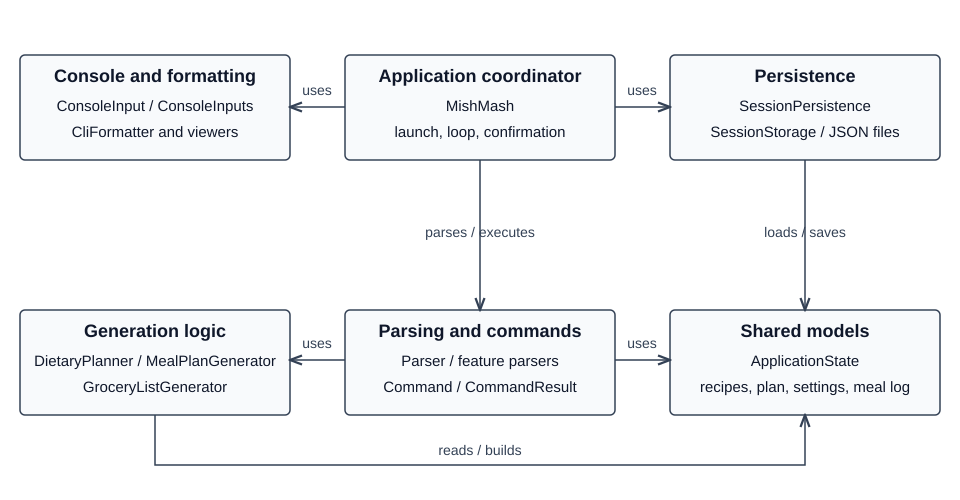

Arrows show dependency or data-access direction, not the timing of calls. The editable SVG groups classes by responsibility; it does not imply AB3-style manager interfaces. `MishMash` connects the console, parser, shared state, and persistence at startup. Commands use model data and generation services; persistence restores and saves the same shared roots.

The application separates terminal interaction, command handling, application data, and output formatting. The main application coordinates these components throughout a single command session.

| Area | Current responsibility |
| --- | --- |
| Application and user interaction | Display the greeting, read commands, obtain confirmation when required, and show results or errors. |
| Command handling | Recognise commands, validate their arguments, and perform the requested action. |
| Model | Hold recipes, nutrition information, meal plans, generated groceries, and recorded meals. |
| Generation logic | Produce meal plans and consolidate grocery quantities. |
| Display formatting | Present recipes, meal plans, grocery lists, and recorded meals consistently as text. |

Command names and prefixes are case-sensitive. Invalid commands normally produce an error and allow the user to continue. The application accepts one command per line and ends when the user enters `bye` or console input ends.

### UI Component

`MishMash` owns the terminal input loop, greeting, name prompt, command execution, confirmation prompts, and
recoverable error display. Classes in `mishmash.ui` format recipes, plans, groceries, and recorded meals as text.
Commands return `CommandResult` values to the loop rather than reading console input themselves. Each result
explicitly selects `DONE`, `NOTE`, `WARNING`, `INFO`, or `HELP`; `CliFormatter` never guesses from a command class
or message prefix. The first three render as `[DONE]`, `[NOTE]`, and `[WARN]`; `INFO` remains unlabelled.
The default is `INFO`, so a new command cannot accidentally claim success. This keeps command execution and
presentation testable without an interactive terminal.

The command loop passes original input to `Parser`, which rejects unsupported control characters before
trimming. Exit matching accepts only `bye` and its ordinary surrounding whitespace; NUL-padded text cannot
silently become an exit request. `CliFormatter` escapes untrusted terminal controls before adding its own
ANSI styles, including text restored from saved data. Printable Unicode, tabs and multiline feedback remain
intact. `HostileCommandTest`, formatter tests, session tests and `StorageJarTest` cover malformed numbers,
literal symbols, Unicode, recovery after rejected commands, and retained data after JAR restarts.

### Logic Component

The logic covers command parsing, application actions, and generation. A normal command follows this flow:

1. `MishMash` reads a line through `ConsoleInput`.
2. `Parser.parseCommand` validates syntax and constructs a command; feature parsers handle specialised fields.
3. `MishMash` obtains the command's optional confirmation prompt. Cancellation skips execution.
4. `Command.executeWithResult` reads or updates the shared models and returns a `CommandResult`.
5. `SessionPersistence.afterCommand` saves mutation outcomes before `CliFormatter` displays feedback. A save failure retains live state and produces a warning.
6. Recoverable `MishMashException` failures display error/usage feedback and return to the loop; `bye` and EOF flush pending saves and exit.

The logic supports the following commands:

| Command | Purpose |
| --- | --- |
| `add-recipe` | Add a recipe with nutrition information and ingredients. |
| `list-recipes` | List stored recipes or display one recipe in full. |
| `edit-recipe` | Replace selected fields of a recipe at its displayed index. |
| `delete-recipe` | Remove a recipe by its displayed index after confirmation. |
| `set-diet` | Replace the session dietary profile and repair or clear conflicting planned days. |
| `view-diet` | Display the session dietary profile. |
| `clear-diet` | Reset the dietary profile while preserving all other session data. |
| `set-targets` | Save, replace, or remove daily calorie, protein, carbohydrate, and fat targets for later plans. |
| `view-targets` | Display the saved daily targets. |
| `generate-plan` | Generate one to seven days of meals, optionally using daily nutrition targets. Saved targets fill in nutrients that the command leaves out. |
| `reset-plan` | Clear the current plan, its generation request, and derived groceries; preserve other session data. |
| `view-plan` | Display the active meal plan or one selected day. |
| `adjust-portion` | Change one planned meal's positive whole-recipe portion count. |
| `customize-meal` | Replace one planned meal occurrence's ingredients without editing its recipe. |
| `replace-meal` | Replace one planned meal with a recipe chosen by its displayed index, subject to dietary preferences. |
| `check-shortfall` | Compare each planned day's nutrition with explicit daily targets and report deficits. |
| `generate-list` | Generate groceries for the active meal plan. |
| `view-list` | Display the generated grocery list. |
| `record-meal` | Record the recipe at a displayed index as a meal eaten. |
| `view-meals` | Display the recorded meals, or one date's meals, with their nutrition and totals. |
| `edit-meal` | Correct the date or servings of a recorded meal. |
| `delete-meal` | Remove a recorded meal after confirmation. |
| `help` | Display the supported commands and their formats. |
| `bye` | End the session. |

Commands validate their arguments and relevant application state. Requests that fail validation leave the existing data unchanged. Generation and viewing are separate actions: viewing does not create a new plan or grocery list.

### Model Component

| Model group | Responsibility |
| --- | --- |
| `ApplicationState` | Shares the recipe book, active plan, dietary settings, target settings, and meal log. |
| `RecipeBook`, `Recipe`, `GroceryItem` | Ordered recipes, their nutrition/classification, and decimal ingredient quantities with units. |
| `ActiveMealPlan`, `MealPlan`, `DayPlan`, `PlannedMeal` | One active plan, its generation request and groceries; days contain recipe snapshots with whole portions and optional ingredient overrides. |
| `DietarySettings`, `DietaryPreferences`, `Diet`, `FoodTag`, `FoodInfo` | Current restrictions and declared recipe classifications. |
| `TargetSettings`, `NutritionTargets`, `NutritionTotals` | Saved targets, applied constraints, and totals held as `long` values. |
| `MealLog`, `MealEntry` | Recorded recipe snapshots with dates and whole-serving counts, separate from planned meals. |

Validated request/change objects and their interactions are described under the corresponding [Implementation](#implementation) feature.

Recipe indexes start at 1 and change after deletion; duplicate names are allowed. Editing replaces an entry without shifting indexes. Existing plans and recorded meals retain independent recipe snapshots after recipe edits or deletion.

Saved targets apply during generation; changing them later does not change an existing plan's applied targets. Successful replacement generation clears old groceries; failed generation preserves both plan and groceries. Ingredients and groceries use `GroceryItem`; there are no separate `Ingredient` or `GroceryList` classes.

### Storage Component

`ApplicationState` owns all five shared model roots. The production launcher restores them through `SessionStorage`, builds `Parser(ApplicationState)`, and uses `SessionPersistence` to autosave completed changes. See [Persistence and recovery](#persistence-and-recovery).

Diagnostic logs remain separate from the versioned JSON user-data snapshot.

#### Persistence and recovery

`ApplicationState` shares recipes, `ActiveMealPlan`, dietary settings, target settings, and `MealLog` between
the parser and storage. Existing parser/session constructors still create isolated in-memory sessions;
the public production entry point restores state before opening the command loop. This keeps tests from
reading or overwriting a developer's real data. `StorageJarTest` covers the actual production launcher.

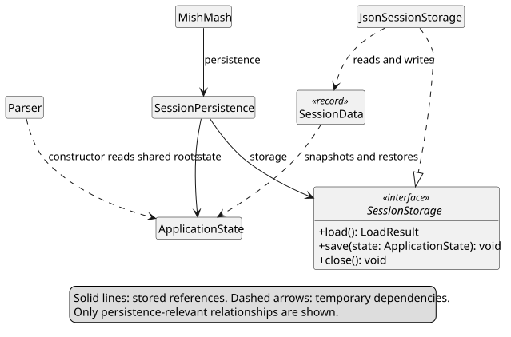

`SessionData` is a storage-only record hierarchy with schema version 2. Recipe values are embedded independently
in the recipe book, planned occurrences, and recorded meals. Orders and duplicates are preserved; sets are sorted
for deterministic output. Recorded entries retain their ISO calendar date and whole-serving count. Decimal
quantities are plain strings and nullable targets use JSON null. Null groceries
mean not generated; an empty array means a generated empty snapshot. Restoration uses domain constructors,
including exact ordered ingredient equality from the defensive PR fixes.

Jackson rejects duplicate/unknown/missing fields, scalar coercion, fractional integer values, trailing JSON,
and null primitives. Parsing limits document size to 10 MiB, depth to 100, strings to 1,000,000 characters,
and numeric tokens to 1,000 characters. No polymorphic typing or native Java serialisation is enabled.
Only validated snapshots are published; malformed data cannot partially update application state.

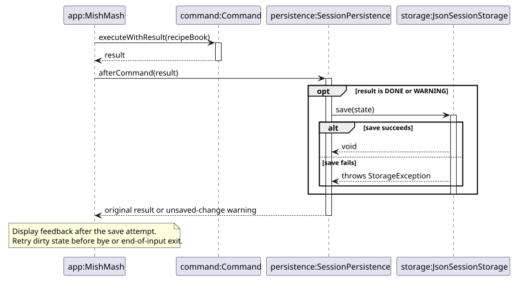

`SessionPersistence` marks `DONE` and `WARNING` outcomes dirty and saves before presenting feedback. Notes,
read-only output, cancelled commands, and parse/execution errors do not trigger autosave. A failed save retains
the live state, produces warning feedback, and retries after the next mutation and on normal exit. Future
state-changing commands must report a mutation outcome; presentation status currently supplies that contract.
Unexpected application failures are still logged and rethrown; they do not trigger an unsafe final save.

`JsonSessionStorage` holds an exclusive `FileChannel` lock for the process lifetime. Writes validate the JSON,
flush a same-directory temporary file, preserve the previous valid backup, and replace the primary with an
atomic move where supported. Filesystems without atomic replacement fall back to replacement plus backup
recovery. Temporary-file cleanup is best effort. An unreferenced `.tmp` is never loaded automatically.
Operating-system locks and file flushing do not provide a guarantee against every power or hardware failure.

Startup distinguishes invalid JSON from filesystem access failure. Only invalid files are quarantined;
an inaccessible file or a failed backup restoration stops startup. Recovery never quarantines a valid backup
merely because writing the primary failed. Unsupported versions are preserved like malformed snapshots;
version 1 snapshots are upgraded automatically to version 2. Legacy undated records receive the local upgrade
date and one serving, with warning feedback. The original file is retained as the backup. The upgrade is saved
immediately so repeated restarts do not change those assigned dates. Failed upgrades stop startup and preserve
the original primary; they never classify a valid legacy file as corrupt.

Run Java 25 `./gradlew check shadowJar`. Storage tests use temporary directories and cover round trips,
validation, locks, backups, quarantine, write failures, and retry behaviour. The check task also builds and runs
the shadow JAR through multiple processes to verify retention from a working directory outside the repository.
JAR tests also cover forced termination after autosave, lock release, corrupt-primary recovery, unsaved-change
warnings and shutdown retries, failed dietary repair, and unchanged save files after no-ops or cancellation.

### Common classes

Shared types remain in the packages that define their responsibilities:

| Type | Shared responsibility |
| --- | --- |
| `command.CommandResult` | Carries feedback and an explicit outcome from commands to the UI and persistence coordinator. |
| `exception.MishMashException` | Carries recoverable errors, optional command-specific usage, and the original cause from parsing or execution to the application. |
| `parser.IngredientParser` | Validates ingredient syntax for adding recipes, editing recipes, and customising planned meals. |
| `model.GroceryItem`, `model.NutritionTotals` | Provide validated ingredient quantities and nutrition values used by planning, viewing, and storage. |

## Implementation

This section explains the design and implementation of MishMash’s completed features, including their key components, workflows, and error handling.

<!-- @@author peilingggg -->
### Adding a recipe
*Section author: peilingggg*

`add-recipe` creates a recipe from its name, nutrition, ingredients, and optional food
categories. This supports the user story: **As a first-time user, I want to add a recipe
with its ingredients and quantities so that I can create a personalised meal.** The
[User Guide](UserGuide.md#adding-a-recipe) gives the command rules and examples.

```text
add-recipe n/DISHNAME cal/CALORIES p/PROTEIN c/CARBS f/FATS i/INGREDIENT:QUANTITYUNIT [i/INGREDIENT:QUANTITYUNIT ...] [food/TAG[,TAG...]]
```

All five recipe fields and at least one ingredient are required. Fields may appear in
any order; only `i/` may repeat. Recipes are autosaved for later sessions.
Adding a recipe leaves existing recipes, meal plans, groceries, and recorded meals unchanged.

#### Responsibilities

| Component | Responsibility |
| --- | --- |
| `Parser` | Read prefixed fields, validate values, and create a recipe and command without changing the book. |
| `Recipe`, `GroceryItem` | Hold validated recipe data and precise decimal ingredient quantities. |
| `FoodInfo`, `FoodTag` | Represent the optional food-category declaration and validate supported tags. |
| `AddRecipeCommand` | Prepare the confirmation, then append its validated recipe to the supplied book. |
| `RecipeBook` | Store recipes in insertion order, including duplicate names. |
| `RecipeViewer` | Format recipe details consistently with listing and editing. |
| `MishMash` | Parse and execute the command, print its result or error, and continue the input loop. |


*Selected stored references. Open arrowheads show navigability, with target
multiplicities and private role names. Members, temporary dependencies, and `Command`
realization are omitted; `AddRecipeCommand` implements `Command`.*
[PlantUML source](diagrams/peilingggg/add-recipe/classes.puml)

The command stores one recipe; the book and viewer are supplied or created during execution.
The book and ingredient lists preserve order and allow repeated entries. `Recipe` copies
the ingredient list with `List.copyOf`, protecting its structure without deep-copying the
`GroceryItem` objects. Plain associations allow references to be shared with other features.

#### Parsing and object creation

For example, `add-recipe n/Rice cal/200 p/4 c/45 f/1 i/Rice:150g food/none` creates one
recipe containing a 150 g ingredient and an explicit empty food-category declaration.


*Successful parsing. Dispatch helpers, ingredient creation, field validation,
and library operations are condensed in the note. Only the recipe and command constructors
are expanded. Parameters abbreviated with `...` are described below; parsing never updates the book.*
[PlantUML source](diagrams/peilingggg/add-recipe/parsing.puml)

1. `collectRecipeArguments` identifies prefixed fields, including unsupported prefixes,
   so an unknown field cannot silently become part of a name. `readArgument` stores
   single-value fields and appends each parsed `i/` item to a local list.
2. `validateRequiredFields` checks `n/`, `cal/`, `p/`, `c/`, `f/`, and at least one ingredient.
   `parseNutrition` then reads calories, protein, carbohydrates, and fats, in that order,
   as non-negative integers. Ingredient quantities use `BigDecimal`.
3. `FoodInfo.parseField` reads the optional declaration. Missing `food/` means unclassified;
   `food/none` means no supported categories apply. Other values are validated tags, never
   inferred from ingredient names.
4. Only after validation succeeds does the parser construct `Recipe` and `AddRecipeCommand`.
   The recipe constructor independently checks its constraints to protect direct Java callers.

#### Execution and output

The inherited `Command.confirmationPrompt` returns an empty `Optional`, so addition does
not ask for confirmation. The execution diagram starts when `MishMash` calls `execute(recipeBook)`.


*Successful execution. Calls have filled arrowheads and returns are dashed.
Constructor activations start below the newly created object boxes. Formatting internals,
logging, the confirmation check, and application printing are omitted.*
[PlantUML source](diagrams/peilingggg/add-recipe/execution.puml)

1. `AddRecipeCommand.execute` rejects a null book, creates `RecipeViewer`, and prepares
   the full confirmation before inserting anything. A formatting failure therefore cannot
   leave an addition without a prepared confirmation.
2. `RecipeBook.add` checks the recipe is non-null and appends its reference. Duplicate names
   and repeated ingredients remain separate entries; grocery generation handles aggregation.
3. The command returns the confirmation. `MishMash` prints it and prompts for another command.
   For the Rice example:

```text
New recipe added!
Rice
200 kcal | Protein: 4g | Carbs: 45g | Fats: 1g
Ingredients:
- Rice: 150g
Food tags: None declared
```

Ingredient quantities display as plain decimals without unnecessary trailing zeros.
`RecipeViewer` also displays sorted food tags, or `Unclassified` when `food/` was omitted.

#### Error handling and defensive checks

| Input or condition | Result |
| --- | --- |
| Missing required field, no ingredient, or unprefixed leading text | Reject before creating an addition command. |
| Blank value, unknown prefix, embedded `/`, or repeated single-value field | Reject; repeated `i/` fields remain valid. |
| Nutrition outside `0` to `Integer.MAX_VALUE`, including signs and decimals | Reject; zero and leading zeros are valid. |
| Non-positive quantity, missing unit, malformed decimal, or extra colon | Reject; quantities require digits before and after a decimal point when present. |
| Unit containing characters other than ASCII letters | Reject; accepted units are not converted or checked against a fixed vocabulary. |
| Unsupported, blank, or repeated food tag | Reject; `food/none` cannot be combined with other tags. |
| Null Java dependency or required model argument | Fail with `NullPointerException`, indicating a caller contract violation. |

For example, `i/Rice:0g` is rejected by `parseIngredient` before a `GroceryItem` is created.
`parseAddRecipeCommand` wraps parsing failures in `MishMashException`, preserves the cause,
and adds `ADD_RECIPE_USAGE`. The application displays the error and accepts another command;
existing recipes remain unchanged. Although `GroceryItem` permits zero, recipe parsing and
the `Recipe` constructor enforce a strictly positive ingredient quantity.

#### Alternatives and limitations

| Decision | Alternative | Reason |
| --- | --- | --- |
| Validate before insertion | Add a partial recipe first | Invalid input cannot leave an incomplete book entry. |
| Validate in both parser and model | Trust the parser alone | Syntax checks and model contracts protect different callers. |
| Use `BigDecimal` quantities | Use floating-point quantities | Preserve entered decimal precision. |
| Reuse `RecipeViewer` | Format separately in each command | Keep addition, listing, and editing output consistent. |

Names identify display text rather than unique keys, and repeated names are accepted.
Food categories depend on user declarations. No unit conversion is
provided by addition. To use a newly added recipe in generated data, generate a new plan,
then generate its grocery list.

#### Automated verification

- `AddRecipeBoundaryTest` covers nutrition limits, quantities, whitespace, ordering, and repeated ingredients.
- `AddRecipeEdgeCaseTest` uses `add-recipe-invalid.tsv` to check rejection, unchanged data, and recovery.
- `AddRecipeExceptionTest` checks command usage and preserved causes.
- `AddRecipeCommandTest`, `RecipeTest`, and `RecipeBookTest` cover insertion, output, null contracts, and collection protection.
- `MishMashTest` covers console interaction and continued input after errors.

Run `./gradlew test checkstyleMain checkstyleTest` with Java 25 (Windows:
`.\gradlew.bat test checkstyleMain checkstyleTest`). Sources and SVG maintenance instructions
are in [diagrams/add-recipe](diagrams/peilingggg/add-recipe/README.md).


<!-- @@author -->

<!-- @@author neil0618 -->
### Listing recipes

*Section author: neil0618*

#### Purpose and command contract

This feature implements the story: **As a user managing recipes, I want to list my recipes and inspect a selected recipe so that I can find and check its stored details.**

`list-recipes [INDEX]` has two forms. Without an index it shows every recipe as a numbered line with its name and calories. With an index it shows that one recipe in full: nutrition, ingredients, and food tags. The index is one-based and equals the number shown in the list, which is also the number that `edit-recipe` and `delete-recipe` expect. For example, `list-recipes 2` shows the second recipe. Listing is read-only: it never changes the recipe book, the active plan, or the grocery list.

#### Class responsibilities and relationships

`Parser` validates the optional index and creates a `ListRecipeCommand`. The command keeps only a nullable `Integer index`, where `null` means "list every recipe". The recipe book is supplied only when `executeWithResult` runs, so the command reads the recipes as they are at that moment rather than a copy taken during parsing. Recipe details are formatted by `RecipeViewer`, the class that also formats the `add-recipe` and `edit-recipe` confirmations, so a recipe looks the same wherever it is shown.

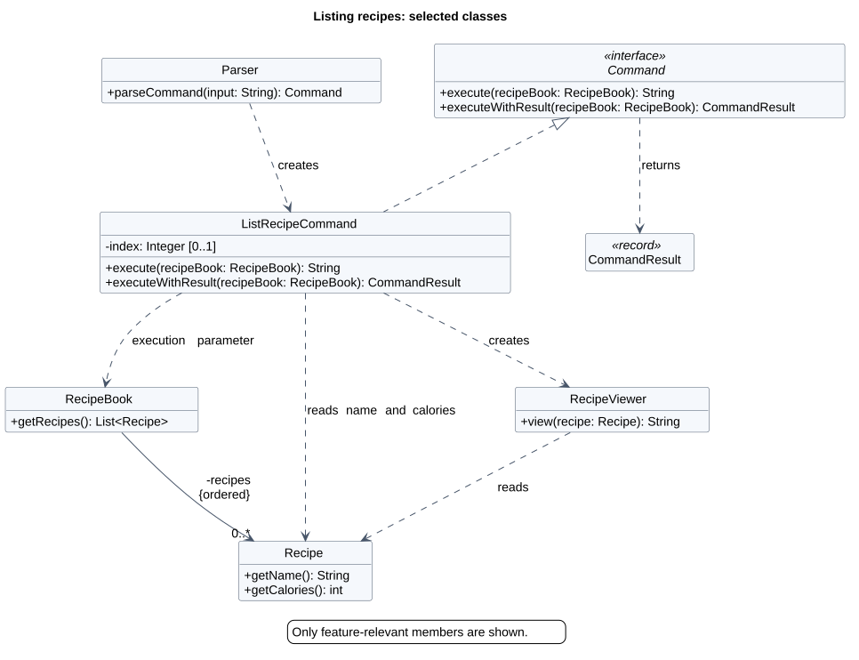

*Only feature-relevant members are shown. Dashed arrows with an open head are dependencies; the dashed arrow with a hollow triangle is interface realization; the solid arrow is an association with a role name and multiplicity. `RecipeBook.getRecipes` returns a read-only copy, so listing cannot change the book.*

#### Parsing and execution

The successful `list-recipes 2` scenario is separated into parsing and execution. Invalid and
no-index outcomes are described afterwards so both interactions remain readable at guide width.

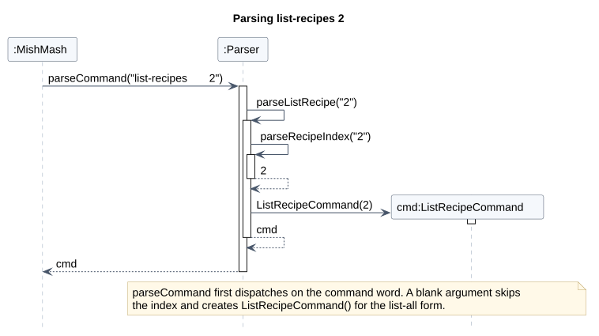

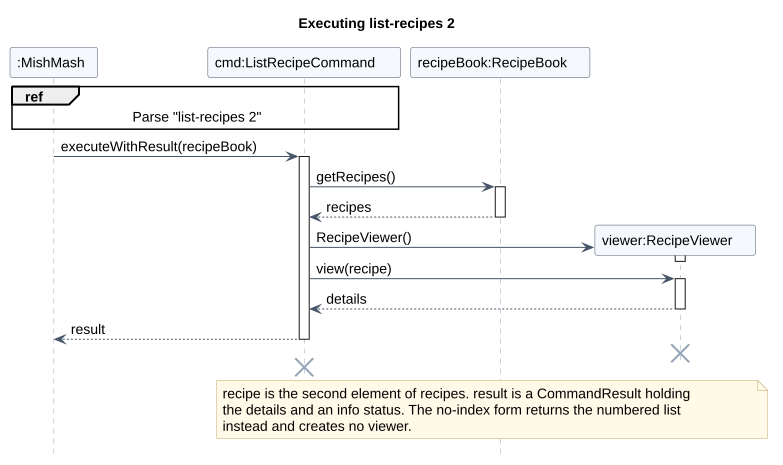

*The execution diagram refers to the parsing diagram with a `ref` frame. The no-index form skips index parsing and the viewer. The `X` marks objects that are no longer used after the command returns.*

`Parser.parseListRecipe` treats blank arguments as the list-all form. Otherwise it calls `parseRecipeIndex`, the helper that `delete-recipe` also uses. The helper accepts digits only and rejects zero and values above `Integer.MAX_VALUE`. Leading zeros and surrounding spaces are accepted, so `list-recipes 01` selects recipe 1.

The parser does not receive the recipe book, so whether the index exists is decided at execution. `MishMash` calls `executeWithResult`, which reads the book, then either returns a `CommandResult` holding the details of `recipes.get(index - 1)` or throws a `MishMashException`. `execute` is kept for callers that only need the text and returns the `feedback` of that `CommandResult`. The list-all form returns `Recipes:` followed by one `N. name (calories kcal)` line per recipe, or `No recipes yet. Use 'add-recipe' to add one.` for an empty book. An empty book is therefore an error only when an index was requested.

#### Invalid input and recovery

| Input or state | Where it is caught | Result |
| --- | --- | --- |
| Index that is not digits only (`abc`, `-1`, `1.5`, `1 2`), is `0`, or exceeds `Integer.MAX_VALUE` | `Parser.parseRecipeIndex` | Error ending with `Format: list-recipes [INDEX]`. |
| Valid index, empty book | `ListRecipeCommand.execute` | Error telling the user to add a recipe. |
| Valid index above the recipe count | `ListRecipeCommand.execute` | Error stating the valid range. |
| No index, empty book | `ListRecipeCommand.execute` | Normal message, not an error. |
| Command word with a different case or spelling (`List-Recipes`, `list-recipe`) | `Parser.parseNamedCommand` | `Unknown command` error. |

Syntax errors start as an `IllegalArgumentException`. `parseListRecipe` wraps it in a `MishMashException` that keeps the original cause and ends with the list-recipes usage, so `MishMash.displayError` does not print the general command list. The two execution-time errors pass `ListRecipeCommand.USAGE` as well, so they also show only the list-recipes format. In every case the session continues and the recipe book is unchanged.

#### Design choices and alternatives

| Decision | Alternative | Reason for the current design |
| --- | --- | --- |
| One command with an optional index | A separate `show-recipe INDEX` command | There is one command word to learn, and the numbered list shows exactly the numbers that `edit-recipe` and `delete-recipe` need. |
| Look the recipe up when the command executes | Look it up while parsing | The parser stays independent of application data, as for the other recipe commands, and the lookup sees the book as it is when the command runs. |
| A nullable `index` means "list all" | Two command classes, or an `Optional<Integer>` field | It is the simplest option that is sufficient, and both forms share the book access. Two classes would be worth it if the forms diverged. |
| The list shows only names and calories | Show all nutrition for every recipe | A compact list stays readable for a long book, and full details are one command away. |
| Reuse `RecipeViewer` for the details | Format the text inside the command | A recipe is displayed identically after `add-recipe`, `edit-recipe`, and `list-recipes`. |

#### Verification and maintenance

`ListRecipeCommandTest` checks the numbered list, empty and duplicate-name books, the full details of the first, last, and a duplicate-named recipe, out-of-range and empty-book errors with the book left unchanged, repeated calls, and null arguments. `ParserTest` checks both forms, accepted variations such as leading zeros and extra whitespace, invalid arguments showing only the list-recipes usage, the largest index (which parses and fails only at execution), and near-miss command words. `MishMashTest` checks the console flow: the list followed by one recipe in full, an empty book, a bad index followed by recovery, and the numbers matching those used by `delete-recipe`.

For manual verification, follow [List Recipes](#list-recipes) in the manual-testing appendix, or the User Guide's [Listing Recipes](UserGuide.md#listing-recipes) example. The class diagram and sequence diagram have editable sources and rendering instructions in [`docs/diagrams/neil0618/list-recipes`](diagrams/neil0618/list-recipes/README.md). When the implementation changes, check method names, message order, and the error paths against the code, then regenerate and inspect both SVGs.

<!-- @@author -->

<!-- @@author Rixte -->
### Editing a recipe

*Section author: Rixte*

`edit-recipe INDEX` changes selected fields of the recipe at a one-based displayed index.
For example, `edit-recipe 1 p/55 i/Chicken:220g i/Rice:150g` replaces its protein and entire
ingredient list. Omitted fields stay unchanged. The
[User Guide](UserGuide.md#editing-a-recipe) gives the complete syntax.

#### Responsibilities

| Component | Responsibility |
| --- | --- |
| `Parser.parseEditRecipe` | Validate the index and supplied fields using the shared recipe helpers. |
| `RecipeChanges` | Store immutable optional edits and build a validated replacement. |
| `EditRecipeCommand` | Look up the current recipe, format feedback, and then publish the edit. |
| `RecipeBook` | Replace one entry without changing the recipe count or indexes. |
| `RecipeViewer` | Format every field of the edited recipe. |


*Selected stored references and temporary dependencies. The book's ordered list permits
repeated references; existing plans may retain the original recipes. Parser creation,
viewer dependencies, and the command interface are omitted.*
[PlantUML source](diagrams/rixte/edit-recipe/classes.puml)

Nullable scalar fields in `RecipeChanges` mean unchanged; an empty ingredient list also
means unchanged. Nullable nutrition distinguishes an omitted field from an explicit zero.
Supplied ingredients replace the complete list. Omitted `food/` preserves the previous
declaration, and changing ingredients does not infer new food categories.

#### Parsing and execution

Parsing reuses `collectRecipeArguments`, `parseOptionalNutrition`, and `parseIngredient`.
Single-value prefixes cannot repeat; ingredient prefixes can. Validation finishes before
a command is created, without looking up or changing any stored recipe.


*Successful execution for a valid index. `original` is the snapshot entry at `index - 1`.
Field getters, replacement construction, logging, and assertions are condensed;
viewer construction is omitted. Feedback is complete before replacement.*
[PlantUML source](diagrams/rixte/edit-recipe/execution.puml)

1. `execute` checks the current book size and index, then reads the recipe at `index - 1`.
2. `RecipeChanges.applyTo(original)` creates a new `Recipe` from supplied edits and retained fields.
3. `RecipeViewer.view(edited)` formats the replacement; the command prepares the complete feedback.
4. Only then does `RecipeBook.replace(index - 1, edited)` update the book entry.

#### Errors and snapshot behaviour

| Condition | Result |
| --- | --- |
| Missing fields, malformed index, unknown or repeated single-value prefix, or invalid field | Parsing raises `MishMashException` with edit usage and the validation cause; no edit is applied. |
| Empty book or index beyond the current size | Reject during execution before creating a replacement. |
| Replacement validation or formatting fails | The book entry has not yet been replaced. |
| Edit succeeds | Recipe count and indexes stay the same; existing plans, groceries, and recorded meals retain their old snapshots. |

Commands resolve indexes during execution, including any renumbering caused by earlier
deletions. To incorporate an edit into planned meals and groceries, generate a new plan
and then a new grocery list. Regenerating groceries alone still uses the existing plan.

#### Design choice and verification

Immutable replacement keeps the change local to the recipe book. Mutating the original
would also change references held by planned or recorded meals and could invalidate
groceries. Replacing the whole ingredient list supports quantity changes and removals
without introducing ingredient identifiers or extra subcommands.

`ParserEditRecipeTest`, `RecipeChangesTest`, and `EditRecipeCommandTest` cover validation,
partial edits, current-index lookup, food declarations, and snapshot preservation.
`EditRecipeIntegrationTest` and `EditRecipeDiagnosticsTest` check command integration and
diagnostics. Manually edit a recipe after generating meals and groceries: both views
should keep the old values until their data is regenerated. A rejected `p/-5` must leave
the last valid recipe unchanged.

<!-- @@author -->

<!-- @@author neil0618 -->
### Deleting a recipe

*Section author: neil0618*

#### Purpose and command contract

This feature implements the story: **As a user managing recipes, I want to confirm the deletion of a selected recipe so that I can check that I am removing the intended entry.**

`delete-recipe INDEX` removes the recipe at the displayed, one-based position. Deletion cannot be undone, so the application first names the recipe and `CliFormatter` presents the question as `[CONFIRM] ... [y/N]:`. Only `y` or `yes`, ignoring letter case and surrounding whitespace, deletes the recipe. Any other answer, including a blank line or the end of input, cancels. For example, `delete-recipe 2` followed by `y` removes the second recipe, and every later recipe moves up one position.

The command changes only the `RecipeBook`. It does not use `ActiveMealPlan`, so an existing meal plan and its grocery list keep the recipes they were generated with. No undo is provided.

#### Where the confirmation lives

`Command` declares `confirmationPrompt(RecipeBook)`, a default method that returns an empty `Optional`. A command that needs confirmation overrides it and returns its question. `MishMash.executeCommand` calls it for every command. If it returns a question, `userConfirms` displays it and reads the next input line, and `execute` runs only if the answer agrees.

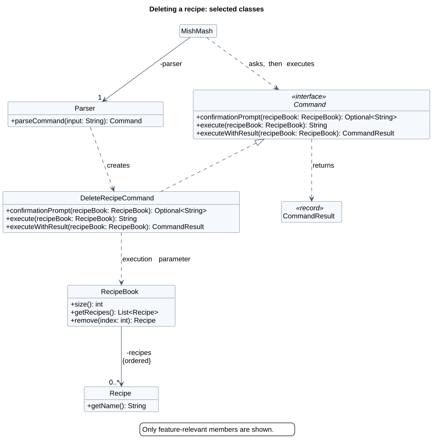

*Only feature-relevant members are shown. Dashed arrows with an open head are dependencies; the dashed arrow with a hollow triangle is interface realization; solid arrows are associations with a role name and multiplicity. `RecipeBook.remove` takes a zero-based index, while `DeleteRecipeCommand` stores the one-based number the user typed.*

This keeps all console input and output in `MishMash`. `DeleteRecipeCommand` only builds the question and performs the deletion, so tests can call both methods directly without a `Scanner`. The question contains the index as well as the name, so recipes with the same name can still be told apart.

#### Execution and confirmation

The first sequence starts after parsing and follows a confirmed `delete-recipe 2`.

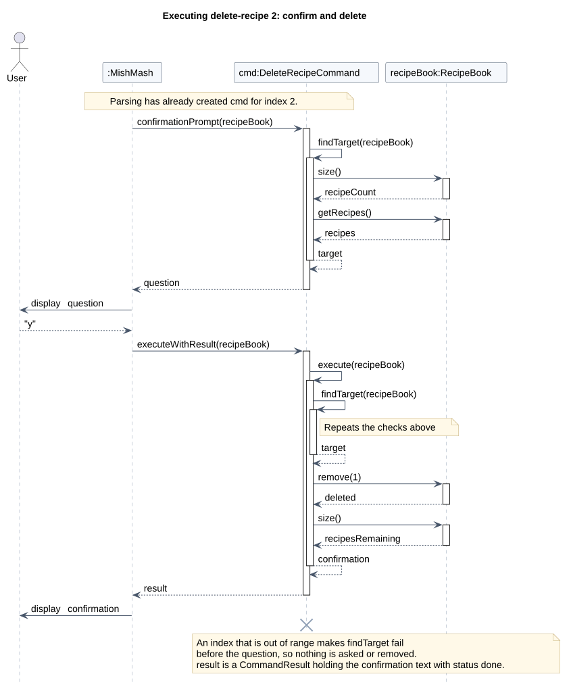

*The command validates the index once while building the prompt and again immediately before removal. The `X` marks the command object, which is no longer used once it has returned. An invalid index is not drawn here because it is covered by the activity diagram below.*

`confirmationPrompt` finds the target through `findTarget`, which throws if the book is empty or the index is too large. An impossible request therefore fails before any question is asked. `execute` calls `findTarget` again instead of trusting an earlier prompt, so it is also safe when called on its own. It then calls `RecipeBook.remove(index - 1)` and returns `Recipe deleted!`, the recipe's name, and `Recipes remaining: N`. `RecipeBook.remove` checks the index itself with `Objects.checkIndex`.

#### Outcomes and invalid input

The activity diagram shows which step decides each outcome.

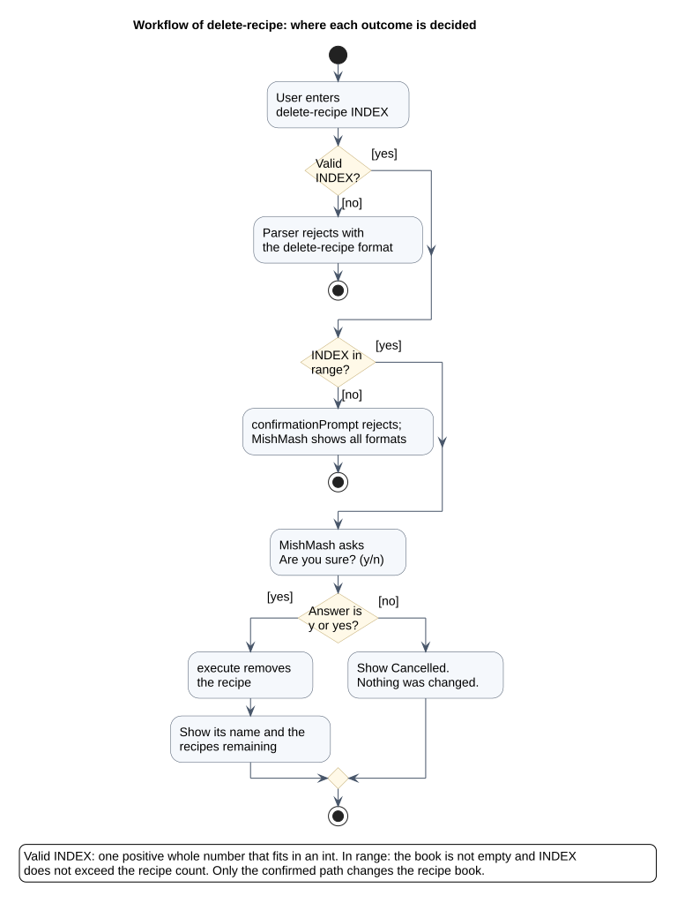

*Diamonds are decisions, with their guards in square brackets. Both error paths end before the question is asked. Only the confirmed path changes the recipe book.*

| Input or state | Where it is decided | Result |
| --- | --- | --- |
| Missing, non-numeric, zero, or oversized index | `Parser.parseRecipeIndex` | Error ending with `Format: delete-recipe INDEX`; no question. |
| Empty book, or index above the recipe count | `DeleteRecipeCommand.confirmationPrompt` | Error followed by the delete-recipe usage; no question. |
| Valid index, answered `y` or `yes` | `MishMash.userConfirms`, then `execute` | Recipe removed and confirmation shown. |
| Valid index, any other answer or end of input | `MishMash.userConfirms` | `Cancelled. Nothing was changed.` |

Syntax errors start as an `IllegalArgumentException`, which `parseDeleteRecipe` wraps in a `MishMashException` that keeps the cause and ends with the delete-recipe usage. After any error or cancellation the session continues with the next command.

#### Design choices and alternatives

| Decision | Alternative | Reason for the current design |
| --- | --- | --- |
| Ask through a default `confirmationPrompt` method on `Command` | Let the delete command read the `Scanner` itself, or pass a context object to `execute` | Commands stay free of console input and output and are easy to test, and every other command is unchanged because of the default. A context object would be worth it if many commands needed shared state. |
| Check the index in `confirmationPrompt`, before asking | Ask first and report the error afterwards | The user is never asked to confirm something that cannot happen. |
| `execute` repeats the checks | Assume the prompt already ran | `execute` is public and must be safe on its own, and the check is only two comparisons. |
| Anything except `y` or `yes` cancels | Ask again until the answer is `y` or `n`, or default to yes | A destructive action must never run by accident, including when input ends. |
| Identify the recipe by position and name it in the question | Delete by name | Recipe names may repeat, so the position is the only unambiguous identifier, and naming the recipe lets the user catch a wrong number. |
| Leave existing plans and groceries unchanged | Remove the recipe from plans or clear them | Plans are snapshots, as for `edit-recipe`, so deleting never silently changes a plan the user is relying on. Automatic repair could be added if it were specified. |

#### Verification and maintenance

`DeleteRecipeCommandTest` checks the confirmation text and removal, the first and last positions, repeated deletion at one index, duplicate names, emptying the book, out-of-range and empty-book errors with the book left unchanged, prompts that never modify the book, and null arguments. `ParserTest` checks a valid index, the question naming the recipe, leading zeros and extra whitespace, invalid arguments showing only the delete-recipe usage, and near-miss command words. `MishMashTest` checks the console flow: a confirmed transcript, a cancellation, end of input cancelling instead of deleting, a missing recipe never producing a question, and a later `edit-recipe` using the renumbered index.

For manual verification, follow [Delete a Recipe](#delete-a-recipe) in the manual-testing appendix, or the User Guide's [Deleting a Recipe](UserGuide.md#deleting-a-recipe) example. The editable diagram sources and rendering instructions are in [`docs/diagrams/neil0618/delete-recipe`](diagrams/neil0618/delete-recipe/README.md). When the implementation changes, check method names, message order, and the decision branches against the code, then regenerate and inspect every SVG.

<!-- @@author -->

<!-- @@author peilingggg -->
### Applying dietary restrictions
*Section author: peilingggg*

`set-diet` replaces the session's dietary profile and applies it to future meal generation.
If an existing plan conflicts, the command can replace its conflicting days and refresh
its groceries. The [User Guide](UserGuide.md#setting-dietary-preferences) describes the
syntax, supported diets, food tags, and examples.

```text
set-diet [diet/DIET] [avoid/TAG[,TAG...]] [exclude/INGREDIENT[,INGREDIENT...]]
```

Omitted fields return to unrestricted defaults. For example, `set-diet avoid/peanut`
clears a previously selected vegan diet. Profiles and recipe classifications are held
in shared holders and retained across sessions.

#### Responsibilities

| Component | Responsibility |
| --- | --- |
| `Parser`, `DietaryPreferencesParser` | Validate arguments, build an immutable replacement profile, and create `SetDietCommand` without changing session data. |
| `Diet`, `FoodTag`, `FoodInfo` | Define diet rules, supported categories, and a recipe's declared classification. |
| `DietaryPreferences` | Check recipes against the named diet, avoided categories, and normalised ingredient exclusions. |
| `DietarySettings` | Hold the current profile shared by setting, viewing, and generation commands. |
| `SetDietCommand` | Request confirmation when needed, coordinate repair, and save the resulting session state. |
| `DietaryPlanner` | Filter eligible recipes and replace incompatible days using `MealPlanGenerator`. |
| `ActiveMealPlan` | Hold the current plan, original generation request, and optional grocery snapshot. |
| `GroceryListGenerator` | Rebuild existing groceries from the repaired plan. |


*Stored references used to apply a dietary update. Each arrow points to one
retained object; unrelated members and references are omitted. `SetDietCommand` also
implements `Command` and stores the proposed `DietaryPreferences`.*
[PlantUML source](diagrams/peilingggg/dietary/classes.puml)

The shared holders expose current session data. `DietaryPreferences` copies its exclusion
sets and normalises ingredient names by trimming, lowercasing with `Locale.ROOT`, and
collapsing whitespace. Collection copies do not deep-copy shared recipes or days.

#### Classifying existing recipes

Recipes added without `food/` are **unclassified**. In contrast, `food/none` explicitly
declares that no supported food categories apply. Any active dietary restriction excludes
unclassified recipes; declarations are not inferred from ingredient names.

Users can classify a recipe they have already added through
[Editing a Recipe](UserGuide.md#editing-a-recipe). For example, if recipe 1 contains soy
and legumes and no other supported categories, enter:

```text
edit-recipe 1 food/soy,legume
```

Use the recipe's current index from `list-recipes`. The `food/` field replaces its complete
category declaration, so include every applicable tag. Omitting other fields preserves
the recipe's name, nutrition, and ingredients. Existing plans and groceries keep their
previous recipe snapshots; run `generate-plan`, then `generate-list` to use the updated
classification in a new plan and grocery list.

#### Parsing and confirmation

`Parser.parseSetDiet` delegates validation to `DietaryPreferencesParser.parse`, then creates
`SetDietCommand` without changing session data. At least one supported field is required;
each prefix may appear once in any order. Unsupported prefixes, unprefixed text, blank
values, embedded slashes, and duplicates are rejected. Diet and tag values ignore case;
aliases and ingredient names are normalised before duplicate detection.

Before execution, `MishMash` calls `confirmationPrompt`. Only a conflicting active plan
requires agreement. Declining skips execution and preserves all state.

#### Repairing conflicting days

The repair and publication sequence diagrams split one confirmed `SetDietCommand.execute` into planning and publication.
This example has conflicting days, a retained generation request, and existing groceries.

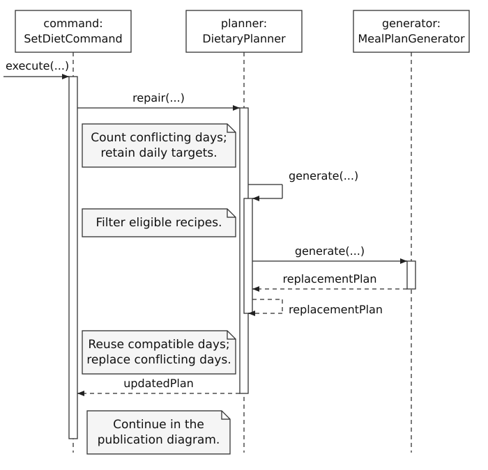

*Building a replacement plan. Parameters are abbreviated with `...`;
compatibility checks, filtering, and day assembly are summarized in notes. The original
plan is unchanged during this sequence. The publication diagram continues the same execution.*
[PlantUML source](diagrams/peilingggg/dietary/repair.puml)

1. The command reads the active plan and its original `GeneratePlanRequest`, then calls
   `DietaryPlanner.repair` with the current recipe pool and proposed preferences.
2. The planner counts incompatible days and requests that many replacements, retaining
   the original daily nutrition targets.
3. `generate` filters recipes through `DietaryPreferences.isAllowed`, then delegates to
   `MealPlanGenerator`. Any active restriction requires classified recipes. A recipe must
   satisfy the named diet, explicit category exclusions, and complete ingredient-name
   exclusions together. Matching does not infer synonyms, substrings, or undeclared tags.
4. The planner reuses compatible `DayPlan` objects at their original positions and replaces
   every conflicting day in full. For example, if only Day 2 conflicts in a three-day plan,
   Days 1 and 3 remain the same objects; all three meals in Day 2 may change.

Generation retains three distinct recipes per day, the +/-15% nutrition tolerance, and
bounded candidate search. Three eligible recipes alone do not guarantee a feasible plan.

#### Updating groceries and saving the result


*Continuing the repair sequence when groceries already exist. The grocery generator is
created at its constructor message. Optional handling, validation, and formatting are
omitted and arguments abbreviated with `...`; dashed arrows show returns.*
[PlantUML source](diagrams/peilingggg/dietary/execution.puml)

1. If groceries already exist, `GroceryListGenerator.generateForPlan` rebuilds them from
   every meal occurrence in the updated plan. Otherwise groceries remain absent, and
   the confirmation advises the user to run `generate-list` later.
2. `ActiveMealPlan.setGenerated` validates the plan length and copies the grocery snapshot
   before assigning the new plan, original request, and groceries.
3. `DietarySettings.set` saves the proposed profile, and the command returns its confirmation.

Other outcomes are summarized below:

| Situation | Result |
| --- | --- |
| No active plan | Clear stale generated state and save the profile for future generation. |
| Entire plan is compatible | Save the profile; preserve the plan and groceries. |
| Conflicting plan; user declines confirmation | Skip execution; preserve the profile, plan, and groceries. |
| Repair succeeds | Save the profile and repaired plan; rebuild groceries only if they already existed. |
| No feasible replacement or original request unavailable | Save the profile, clear the plan, request, and groceries, and explain how to generate again. |

`ActiveMealPlan.set(MealPlan)`, used by legacy callers, discards the original request and
groceries. A compatible legacy plan can be preserved, but a conflicting one cannot be
repaired without its original generation settings.

#### Error handling and defensive checks

Parsing failures raise `IllegalArgumentException`. `Parser.parseSetDiet` wraps the error
in `MishMashException`, preserves its cause, and adds usage. For example, `diet/keto`
reports supported diets and aliases. The main loop displays the error and continues
without changing session data.

During repair, `IllegalArgumentException` instead triggers the save-and-clear outcome
above. Null Java dependencies fail with `NullPointerException`. Assertions check plan
length, dietary compatibility, nutrition targets, and exact use of replacement days;
`AssertionError` denotes an internal programming error.

#### Alternatives and limitations

| Decision | Alternative | Reason |
| --- | --- | --- |
| Use complete, explicit food declarations | Infer categories from ingredient text | Avoid unreliable guesses about synonyms and compound ingredients. |
| Replace the whole profile | Merge supplied fields | Each command defines a complete profile with clear defaults for omitted fields. |
| Filter before invoking the existing generator | Add dietary rules throughout the generator | Reuse its nutrition and variety rules. |
| Replace whole conflicting days | Replace individual meals | Reuse daily nutrition checks while preserving compatible days. |
| Clear generated data after failed repair | Keep the incompatible plan | Keep generated data consistent with the saved profile. |

Classification depends on the user's declarations. The application does not detect
undeclared allergens, cross-contact, or certification.

#### Automated verification

- `DietaryPreferencesParserTest` covers syntax, values, aliases, and malformed lists.
- `DietaryPreferencesTest` and `FoodInfoTest` cover restrictions, classification,
  normalised exclusions, and defensive collection ownership.
- `DietaryPlannerTest` covers filtering, original targets, preserved days, infeasible
  requests, and generator invariant failures.
- `DietaryCommandsTest` covers shared state, profile replacement, grocery rebuilding,
  failed-repair invalidation, and recovery. `ActiveMealPlanGeneratedTest` checks retained
  requests and snapshots. `PlanConfirmationTest` covers dietary-update confirmation and cancellation.

Run `./gradlew test checkstyleMain checkstyleTest` with Java 25 (Windows:
`.\gradlew.bat test checkstyleMain checkstyleTest`). Editable sources and SVG maintenance
instructions are in [diagrams/dietary](diagrams/peilingggg/dietary/README.md).

<!-- @@author -->

<!-- @@author peilingggg -->
### Viewing dietary preferences
*Section author: peilingggg*
#### Purpose and implemented scope

`view-diet` displays `DietarySettings.get().describe()` and accepts no arguments.
It works without recipes or an active plan, including an unrestricted fresh session.

#### Parsing and execution

`Parser.parseNamedCommand` calls `requireNoDietArguments` and returns a `Command` lambda.
The lambda captures the shared holder, rather than a profile snapshot, so a command parsed
before a later update displays the settings current at execution time. It does not read or
change the recipe book, active plan, original generation request, or grocery snapshot.
`DietaryPreferences.describe()` prints the named diet and sorted explicit category and
ingredient exclusions on three lines, using `none` for empty lists.

The viewing sequence diagram ([source](diagrams/peilingggg/dietary/viewing.puml)) shows parsing and execution-time
profile lookup without changing session data.


*The lambda captures the shared settings holder and reads its current profile during
execution. Parsing helpers and formatting internals are condensed; no session data is changed.*

#### Invalid input and verification

Extra arguments raise `MishMashException` with the no-arguments message and `Format: view-diet`.
No command executes and all state is preserved. `ViewDietCommandTest` covers unrestricted and
populated profiles, execution-time reads, and argument rejection without profile changes. Parser tests cover
argument rejection. Run the existing Java 25 test suite when changing this behaviour.

<!-- @@author -->

<!-- @@author oilybikechain -->
### Clearing dietary preferences and restrictions

*Section author: oilybikechain*

`clear-diet` accepts no arguments. `Parser` constructs `ClearDietCommand` without changing
state, and execution calls `DietarySettings.clear` to install a fresh unrestricted profile.
The command deliberately retains only a `DietarySettings` reference, so it cannot mutate the
recipe book, active plan, customised ingredients, portion counts, groceries, saved targets,
or meal log. It also validates the command execution context before clearing, which keeps a
failed invocation atomic.

Clearing an already unrestricted profile is idempotent and reports that nothing changed.
Unlike a restrictive `set-diet` update, clearing cannot make a planned recipe incompatible,
so it does not request confirmation or repair the existing plan. Future generation reads the
new unrestricted profile.

`DietarySettingsTest` and `ClearDietCommandTest` cover complete reset, repeated clearing,
and null boundaries. `ClearDietIntegrationTest` covers deferred parser execution, invalid
arguments, help text, future unrestricted generation, and identity-preservation of unrelated
planning state.
<!-- @@author -->

<!-- @@author neil0618 -->
### Setting and viewing daily targets

*Section author: neil0618*

#### Purpose and command contract

This feature implements two stories: **As a user, I want to set a daily calorie target so that my meal plan can meet my desired calorie intake**, and **As a user, I want to set my daily protein, carbohydrate, and fat targets so that my meal plan can meet my desired macronutrient intake.** One command covers both, because calories and macronutrients are the four fields of `NutritionTargets` and are used together.

`set-targets [cal/CALORIES|none] [p/PROTEIN|none] [c/CARBS|none] [f/FATS|none]` saves daily targets across application sessions. At least one field is required. A field with a positive whole number replaces that target, `none` removes it, and a field that is not mentioned keeps its saved value. `view-targets` shows the saved targets. For example, `set-targets cal/2000 p/150` followed by `set-targets p/none` leaves only the 2000 kcal target.

The saved targets are used by `generate-plan`. For every nutrient that the `generate-plan` command leaves out, the saved target is used; a target typed in `generate-plan` replaces the saved one for that plan only. Neither command changes an existing meal plan, and `check-shortfall` still requires explicit targets. Targets are included in the autosaved application snapshot.

#### Class responsibilities and relationships

`Parser` owns one `TargetSettings` object and passes it to `SetTargetsCommand`, `ViewTargetsCommand`, and `GeneratePlanCommand`, in the same way that it shares `DietarySettings`. `TargetSettings` holds one immutable `NutritionTargets`, which is empty at the start. `SetTargetsParser` turns the arguments into a `TargetChanges`, and `Nutrient` names the four nutrients with their prefix, label, and unit, so the parser, the merge, and the display loop over one list instead of repeating four near-identical branches.

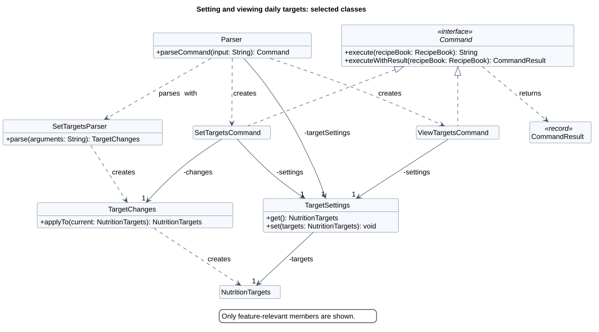

*Only feature-relevant members are shown. Dashed arrows with an open head are dependencies; dashed arrows with a hollow triangle are interface realization; solid arrows are associations with role names and multiplicities. `Parser` creates the one `TargetSettings` and shares it with the commands.*

`TargetChanges` records, for each nutrient the user mentioned, either a new value or `Optional.empty()` for "remove". Nutrients that were not mentioned are absent from its map. This three-way distinction (keep, replace, remove) cannot be expressed with `NutritionTargets` alone, where `null` already means "no target".

#### Setting targets

The activity diagram shows how `set-targets` treats each token, including every way it can be rejected.

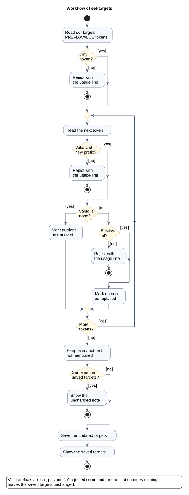

*Diamonds are decisions, with their guards in square brackets. A rejected command, or one that would change nothing, leaves the saved targets unchanged.*

The next two sequence diagrams follow `set-targets cal/2000 p/none`, first parsing and then execution.

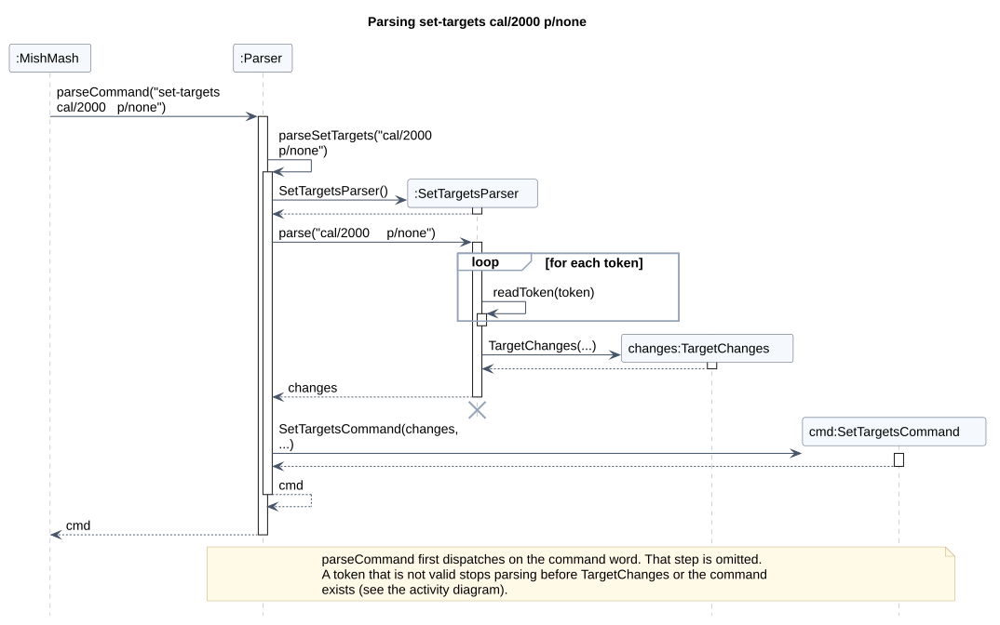

*Parsing succeeds completely before any command exists, so a bad token never changes the saved targets. The `X` marks `SetTargetsParser`, which is no longer used once it has returned the changes.*

`SetTargetsParser` reads each whitespace-separated token as `PREFIX/VALUE`. Prefixes are case-sensitive, like every other prefix, and `none` is accepted in any letter case, as for `food/none`. A value must consist of digits only and fit in an `int`; zero is rejected. The parser validates all tokens before creating a `TargetChanges`, and `Parser.parseSetTargets` wraps any `IllegalArgumentException` in a `MishMashException` that carries the set-targets format as its usage. A command object is created only if every token is valid, so a bad command can never partly change the saved targets.

Once parsing succeeds, execution reads the saved targets, applies the validated changes, and stores
the replacement value unless it equals what is already saved.

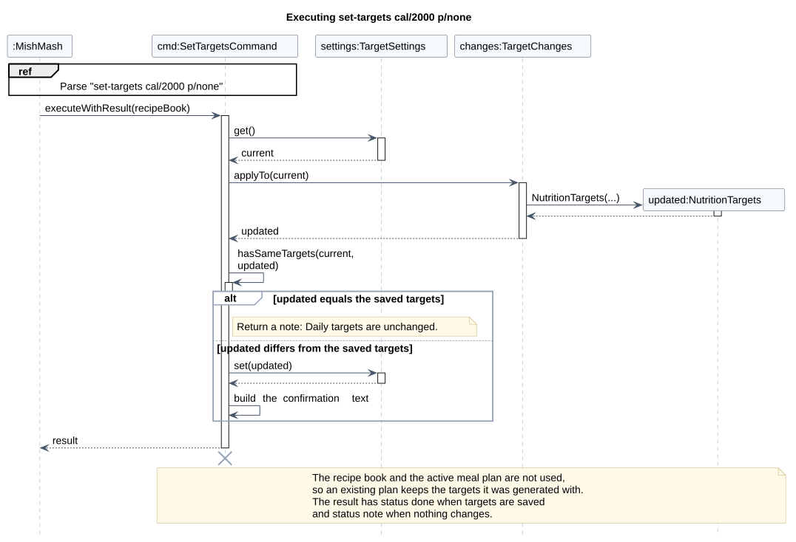

*The execution diagram refers to the parsing diagram with a `ref` frame. Its `alt` frame separates the case where nothing would change, which returns a note without storing anything, from the case that stores the new targets.*

`SetTargetsCommand.executeWithResult` reads the saved targets, asks `TargetChanges.applyTo` for the updated targets, compares them with the saved ones, and stores them. `applyTo` builds a new `NutritionTargets` and does not modify the old one. If the updated targets equal the saved ones, it stores nothing and returns a `NOTE`, `Daily targets are unchanged. Nothing was changed.`, as `ClearDietCommand` does. Otherwise the reply lists every target now saved, or says `All daily targets cleared.` when none remain, and reminds the user that an existing plan is unchanged.

#### Using the targets in `generate-plan`

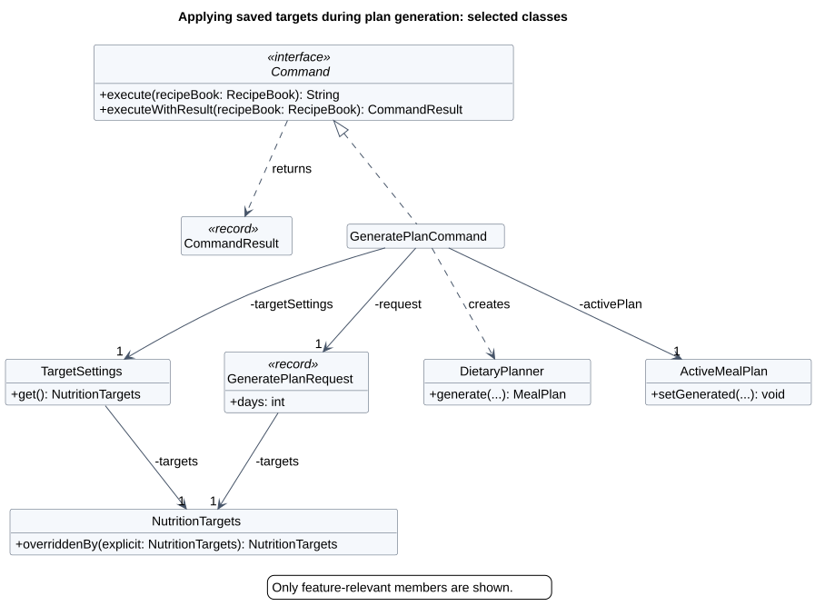

*Each association is drawn once, as a line with its role name and multiplicity, not also as an attribute.*

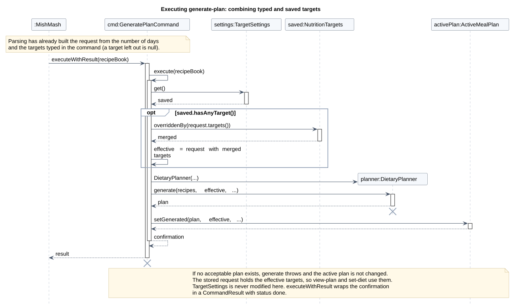

*The `opt` frame runs only when something is saved. The command creates a `DietaryPlanner` for each execution and does not use it afterwards. If no acceptable plan exists, `generate` throws and `ActiveMealPlan.setGenerated` is never called, so the previous plan stays active.*

`GeneratePlanCommand` reads `TargetSettings` when it executes, not when it is created, so a `set-targets` entered after parsing but before execution is respected, exactly as for dietary preferences. If nothing is saved, the request is used unchanged, so behaviour without `set-targets` is identical to before. Otherwise `NutritionTargets.overriddenBy` merges the typed targets over the saved ones and the command builds an effective `GeneratePlanRequest`.

The effective request, not the typed one, is passed to `DietaryPlanner` and stored with `ActiveMealPlan.setGenerated`. This matters in two places that read the stored request later: `view-plan` warns about daily totals that exceed the stored targets, and `set-diet` regenerates conflicting days using the stored targets. If the stored request kept only the typed targets, both would ignore the targets that actually shaped the plan.

When a saved target filled a nutrient that the command left out, the confirmation gains a `Daily targets used:` line and a failure message gains a `Daily targets applied:` line, both listing the merged targets. `GeneratePlanCommand.usesSavedTarget` decides this by checking whether any nutrient has a saved target but no typed one. Without these lines, a user who forgot an earlier `set-targets` would see a failure caused by a target they never typed in the command. When nothing is saved, or every saved nutrient is also typed, the messages are exactly as before.

#### Invalid input and recovery

| Input or state | Where it is decided | Result |
| --- | --- | --- |
| No arguments | `SetTargetsParser.parse` | `Supply at least one daily target to set or clear.` followed by the set-targets format. |
| Unknown, malformed, or wrong-case prefix (`x/5`, `2000`, `CAL/5`, `d/3`) | `SetTargetsParser.readToken` | `Unrecognised parameter: TOKEN` and the format. |
| Repeated prefix | `SetTargetsParser.readToken` | `Parameter cal/ was given more than once.` and the format. |
| Missing value (`cal/`) | `SetTargetsParser.parseValue` | `Missing value after cal/` and the format. |
| Zero, negative, decimal, text, signed, or too large value | `SetTargetsParser.parseValue` | An error naming the nutrient, for example `Calories target (cal/) must be a positive whole number from 1 to 2147483647, or 'none'.`, and the format. |
| Arguments after `view-targets` | `Parser.parseViewTargets` | `view-targets does not accept arguments.` and the view-targets format. |
| Saved target that no combination of recipes can meet | `GeneratePlanCommand.execute` | The generator's error plus `Daily targets applied: ... (including your saved targets). Change those with 'set-targets'.`; the previous plan is kept. |

In every case the session continues, and an error leaves the saved targets unchanged.

#### Design choices and alternatives

| Decision | Alternative | Reason for the current design |
| --- | --- | --- |
| One `set-targets` command for calories and macronutrients | A separate command for calories and another for macronutrients | Both stories change the same object, and a single command lets the user set all four values in one line. Two commands would need two parsers and duplicate the validation for no additional capability. |
| Keep the saved targets in a session holder, `TargetSettings` | Store them in `ActiveMealPlan` or in the recipe book | Targets must survive `generate-plan` replacing the plan, and `ActiveMealPlan` is cleared by `set-diet` in some cases. `TargetSettings` copies the proven `DietarySettings` pattern. |
| Update only the mentioned nutrients | Replace all four targets at once, as `set-diet` replaces dietary preferences | The user can set calories today and protein later without retyping. Removing a target is explicit, with `none`. |
| `none` removes a target | A separate `clear-targets` command | One command and the same word the user already knows from `food/none`. A separate command would be worth adding if clearing everything in one step were needed often. |
| Merge saved and typed targets when `generate-plan` executes, per nutrient | Merge when parsing, or let any typed target discard all saved ones | Execution-time merging respects the latest saved targets and keeps parsing free of session data. Per-nutrient merging lets `generate-plan d/3 cal/1800` change one number and still use the saved protein target. |
| Store the effective request in `ActiveMealPlan` | Store only what was typed | `view-plan` and `set-diet` then use the targets that actually produced the plan. |
| Name the merged targets in the `generate-plan` messages when a saved target contributed | Stay silent, or print the targets on every plan | A user who forgot a saved target can see where a number came from, and output is unchanged when nothing is saved. Printing on every plan would add noise for users who type all their targets. |
| No per-command way to ignore saved targets | Accept `cal/none` in `generate-plan` | Ignoring one needs `GeneratePlanParser` and `GeneratePlanRequest` to represent "explicitly no target", which changes shared code and its tests. `set-targets cal/none` already gives the same result. It could be added if users needed it. |
| Changing targets leaves the current plan alone | Regenerate or clear the plan | Plans are snapshots, as after `edit-recipe` and `delete-recipe`, and regenerating would change meals the user may be relying on. |
| `check-shortfall` is unchanged | Fall back on saved targets when none are typed | Its contract is to check the explicit targets given, and existing behaviour and tests stay valid. It would be a small change to add later. |
| Persist targets with other user data | Separate target file | A complete snapshot avoids restoring targets and plans from different sessions. |

#### Verification and maintenance

`TargetChangesTest` checks setting, keeping, and removing nutrients, that the original targets are never modified, the merge in `NutritionTargets.overriddenBy`, the summary text, and `TargetSettings`. `SetTargetsParserTest` checks every accepted form (any order, extra spaces, `none` in any case, leading zeros, the largest `int`) and every rejection above. `SetTargetsCommandTest` checks the confirmation texts, partial updates, removal, the untouched plan and recipes, `view-targets`, and the interaction with `generate-plan`: saved targets used, typed targets winning per nutrient, saved targets read at execution, removal, a typed target replacing an impossible saved one, a failed generation keeping the previous plan, and the `Daily targets used:` and `Daily targets applied:` lines appearing only when a saved target contributed. `ParserTargetsTest` checks that the parser creates the commands, shares one set of targets between them, reports errors with the set-targets usage only, and lists both commands in the usage and help text.

For manual verification, follow [Set and View Daily Targets](#set-and-view-daily-targets) in the manual-testing appendix, or the User Guide's [Setting Daily Targets](UserGuide.md#setting-daily-targets) example. Editable sources and rendering instructions are in [`docs/diagrams/neil0618/targets`](diagrams/neil0618/targets/README.md). When the implementation changes, check method names, message order, and branches against the code, then regenerate and inspect every SVG.

<!-- @@author -->

<!-- @@author GauthamNandi -->
### Generating a meal plan

*Section author: GauthamNandi*

`GeneratePlanCommand` combines command-specific targets with saved `TargetSettings`, filters recipes through the current dietary profile, and delegates selection to `MealPlanGenerator`. Each day contains three distinct recipes; recipes can recur on other days. With no targets, selection is random. With targets, the generator checks combinations against a 15% tolerance for every supplied nutrient. It checks every combination when there are at most 1,000,000 (about 180 recipes), otherwise up to 1,000,000 random combinations, and keeps at most 5,000 matches. Sampling bounds runtime but can miss a valid combination in a large recipe book.

`ActiveMealPlan` stores the successful plan and its generation request. Replacement generation requires confirmation when a plan exists. Success invalidates previous groceries; failure preserves the prior plan.


<!-- @@author -->

<!-- @@author Rixte -->
### Viewing a meal plan

*Section author: Rixte*

`view-plan [d/DAY_NUMBER]` displays all planned days or one selected day, without generating
meals. See the [User Guide](UserGuide.md#viewing-a-meal-plan) for examples.

#### Responsibilities

| Component | Responsibility |
| --- | --- |
| `Parser.parseViewPlan` | Validate the optional positive day and inject the plan and target suppliers. |
| `ViewPlanCommand` | Read the latest meals, check day bounds, and select the viewer overload. |
| `MealPlanViewer` | Return formatted meals, daily totals, and any target warnings. |

The normal parser connects `mealPlanSource` to `ActiveMealPlan.get()` and
`MealPlan.toMealSummaries()`. `targetsSource` reads the retained generation request,
falling back to `NutritionTargets.none()`. Suppliers are invoked during execution,
so a parsed command sees later regeneration or reset. Injected test sources can differ
from the parser's holder; the command does not store a direct `ActiveMealPlan` reference.

#### Execution


*Successful `view-plan d/1` after parsing, with a nonempty plan. Supplier labels represent
the injected Java functions. Their holder lookups and viewer formatting are condensed;
viewer construction is omitted. With no day, the command calls `view(mealsByDay, targets)`.*
[PlantUML source](diagrams/rixte/view-plan/execution.puml)

1. `execute` calls `mealPlanSource.get()` and creates `MealPlanViewer`.
2. An empty day list returns the generate-first guidance without reading targets.
3. For a selected day, the command checks its upper bound against the current plan.
4. Only then does it read targets and format the selected day; without `d/`, it formats all days.

Nutrition summation and excess warnings are described in
[Combined daily nutrition totals](#combined-daily-nutrition-totals) and
[Detecting exceeded nutrition targets](#detecting-exceeded-nutrition-targets).
Viewing returns text and changes neither planned data nor recipes.

#### Errors and boundaries

| Condition | Result |
| --- | --- |
| Malformed, repeated, non-positive, or overflowing `d/` argument | Reject during parsing with view-plan usage. |
| No active plan or zero days | Return `No active meal plan. Use 'generate-plan' first.`, even if a day was supplied. |
| Selected day exceeds the current plan size | Raise `MishMashException` before reading targets. |
| Valid day contains no meals | Display the day with zero totals. |
| Supplier returns null, or displayed data contains null elements | Throw `IllegalStateException` or `NullPointerException`; `MishMash.run` logs and rethrows the failure, ending the session. |

#### Design choice and verification

Deferred suppliers keep viewing independent of generation and make command reuse and
tests straightforward. Capturing a plan during parsing would display stale data after
regeneration. Keeping formatting in `MealPlanViewer` lets commands return text without
owning terminal output.

`ViewPlanCommandTest`, `ViewPlanIntegrationTest`, `ViewPlanDiagnosticsTest`,
`MealPlanViewerTest`, and the viewing cases in `ParserTest` cover selected days,
missing plans, current-state lookup, large totals, and unchanged groceries and recipes.
Manually generate two days, run `view-plan d/2`, then reset and run the view again;
the second view should report missing data.

<!-- @@author -->

<!-- @@author oilybikechain -->
### Adjusting planned meal portions

*Section author: oilybikechain*

`adjust-portion d/DAY m/MEAL portions/COUNT` changes one recipe occurrence without editing the recipe book.
`AdjustPortionParser` accepts the three required prefixes in any order, rejects duplicates and unknown fields,
and creates an immutable `PortionAdjustment`. Bounds against the current plan are deferred until
`AdjustPortionCommand.execute`, so parsing does not read or mutate session state.

`PlannedMeal` owns a `Recipe` reference and a positive integer portion count. It supplies scaled nutrition as
`long` values and new scaled `GroceryItem` values using `BigDecimal`. `DayPlan` retains its original
recipe-oriented constructor and `getMeals()` compatibility API, while `getPlannedMeals()` exposes portion-aware
data. New generated recipes are wrapped as one-portion planned meals.

The update path is copy-on-write: `MealPlan.withAdjustedPortion` replaces only the selected `DayPlan`, and
`DayPlan.withAdjustedPortion` replaces only the selected `PlannedMeal`. Exact addition rejects nutrition
overflow before publication. `ActiveMealPlan.update` then preserves the original `GeneratePlanRequest` and
clears the grocery snapshot. Validation finishes before field assignment, so a failed adjustment preserves
the plan, request, and groceries. Requesting the current count returns the original objects and does not clear
groceries.

`MealPlan.toMealSummaries` supplies the portion count and scaled nutrition to `MealPlanViewer`. Counts above
one appear as `[N portions]`; one-portion output stays backward compatible. `CheckShortfallCommand` receives
scaled daily totals through `DayPlan`, and `GroceryListGenerator.generateForPlan` aggregates scaled ingredients.

`PlannedMealTest`, `AdjustPortionParserTest`, `AdjustPortionCommandTest`, and
`AdjustPortionIntegrationTest` cover scaling, validation, atomic state changes, viewing, shortfalls, and grocery
generation. Existing model, viewer, and grocery tests provide regression coverage.

<!-- @@author -->

<!-- @@author oilybikechain -->
### Customising planned meal ingredients

*Section author: oilybikechain*

`customize-meal d/DAY m/MEAL i/INGREDIENT:QUANTITYUNIT [...]` replaces the effective one-portion ingredients
of one occurrence. It does not edit `RecipeBook`, the source `Recipe`, nutrition, or other occurrences.
`IngredientParser` centralises the established recipe ingredient grammar so recipe and customisation commands
cannot drift apart.

`CustomizeMealParser` accepts `d/` and `m/` once and repeated `i/` fields in any order. It creates an immutable
`IngredientCustomization`; active-plan bounds remain execution-time checks. `CustomizeMealCommand` constructs
the entire replacement plan before publishing it through `ActiveMealPlan.update`, which preserves the original
generation request and invalidates stale groceries only after success.

`PlannedMeal` stores an optional copied override and exposes effective ingredients independently of its source
recipe. `withIngredients` treats numerically equal `BigDecimal` quantities as equal, returns the same object for
a no-op, and removes the override when values match the source recipe again. Portion changes retain overrides,
and grocery generation multiplies effective quantities by the portion count. Nutrition continues to use the
recipe values because the application has no ingredient-to-nutrition database.

Dietary category checks continue to use the source recipe's declared `FoodInfo`; MishMash cannot infer whether
an arbitrary replacement name belongs to a named-diet or avoided category. Ingredient-name exclusions use the
effective planned-meal ingredients and are rejected before state changes. When category restrictions are active,
an accepted meal that still has custom ingredients returns `WARNING` and asks the user to verify the replacement.
Restoring the source ingredients returns `DONE` because the resulting meal has no unclassified override. Later
`set-diet` compatibility checks still inspect the source declaration together with effective ingredient
exclusions.

Ingredient equality follows grocery aggregation: order, exact names, and exact units are significant, while
numerically equal `BigDecimal` values may use different scales. Only an exact ordered match is a no-op that
preserves the plan and grocery snapshot and returns `NOTE`; recasing or reordering creates an override.

`CustomizeMealParserTest`, `IngredientCustomizationTest`, `CustomizeMealCommandTest`, and
`CustomizeMealIntegrationTest` cover syntax, defensive copying, atomic failure, dietary conflicts, source
recipe isolation, portion composition, display markers, and grocery quantities. Existing recipe parsing tests
protect the shared `IngredientParser` behaviour.

<!-- @@author -->

<!-- @@author neil0618 -->
### Replacing a planned meal

*Section author: neil0618*

`replace-meal d/DAY m/MEAL r/RECIPE_INDEX` swaps one planned meal for a recipe chosen from the recipe book.
`ReplaceMealParser` mirrors `AdjustPortionParser`: it accepts the three required prefixes in any order, rejects
duplicates, unknown prefixes, and non-positive or overflowing numbers, and creates an immutable
`MealReplacement`. Bounds against the current plan and recipe book are deferred until
`ReplaceMealCommand.execute`, so parsing does not read or mutate session state.

`ReplaceMealCommand` receives the shared `ActiveMealPlan` and `DietarySettings` and checks, in order: an active
plan, the day, the meal, and the recipe index (using the displayed one-based position, since recipes can share
names). Choosing the recipe already in that slot at one portion with no customisation returns a `NOTE` and
changes nothing; the comparison is by reference, so a recipe replaced by `edit-recipe` after generation counts as
different and refreshes the plan's snapshot. Otherwise `DietaryPreferences.isAllowed(recipe)` must pass, so a
manual choice cannot bypass the profile saved by `set-diet`; unclassified recipes are rejected while
restrictions are active.

The update path is copy-on-write like the other plan edits: `MealPlan.withReplacedMeal` replaces only the
selected `DayPlan`, and `DayPlan.withReplacedMeal` replaces only the selected `PlannedMeal` with
`PlannedMeal.onePortionOf(recipe)`. This deliberately drops the old meal's portion count and ingredient
customisation, which belonged to the old recipe. Exact addition in `DayPlan` rejects nutrition overflow before
publication and the command reports it as a `MishMashException`. `ActiveMealPlan.update` then keeps the original
`GeneratePlanRequest` and clears the grocery snapshot, so a failed replacement preserves the plan, request, and
groceries.

`ReplaceMealParserTest`, `ReplaceMealModelTest`, `ReplaceMealCommandTest`, and `ReplaceMealIntegrationTest` cover
syntax, position validation, dietary conflicts, the no-op case, atomic failure, overflow, viewing, and grocery
generation.

<!-- @@author -->

<!-- @@author Rixte -->
### Resetting a meal plan

*Section author: Rixte*

`reset-plan` clears the current planning state while keeping the user's other session
information. It takes no arguments. The [User Guide](UserGuide.md#resetting-a-meal-plan)
describes the confirmation and messages.

#### Responsibilities

| Component | Responsibility |
| --- | --- |
| `Parser.parseResetPlan` | Reject arguments and create a command using the shared holder. |
| `ResetPlanCommand` | Request confirmation, clear planning state, and verify the result. |
| `ActiveMealPlan` | Hold and clear the plan, its generation request, and derived groceries together. |

#### Execution


*Successful execution after the [shared confirmation](#confirming-plan-changes).
Postcondition getter calls and logging are condensed in the note.*
[PlantUML source](diagrams/rixte/reset-plan/execution.puml)

1. The command reads whether a plan or groceries were present when execution starts.
2. `ActiveMealPlan.clear()` removes the plan, generation request, and grocery snapshot.
3. The command checks that all three are absent before returning reset or no-plan feedback.

The command holds only `ActiveMealPlan`. Recipes, dietary preferences, personal targets
saved through `set-targets`, and recorded meals are held elsewhere and remain available.
Targets attached to the removed generation request are cleared; saved personal targets
still apply to future generation. Previously returned immutable snapshots remain valid.

#### Errors and boundaries

| Condition | Result |
| --- | --- |
| Arguments supplied | Reject with reset-specific usage before requesting confirmation. |
| No planning state | Clear remains safe; return `No active meal plan to reset.` |
| Groceries remain without a plan, including an empty snapshot | Clear the snapshot as well. |
| `clear()` throws, or any planning state remains afterwards | Raise a recoverable `MishMashException`; keep the original cause when one exists. |

The postcondition is checked even with Java assertions disabled. A failed clear does not
promise rollback of planning state, but the command never changes unrelated session data.

#### Design choice and verification

Reusing `ActiveMealPlan.clear()` keeps clearing in one place. Replacing the holder would
leave the parser and existing commands referring to the old object. Clearing individual
fields in the command would expose model internals and risk leaving stale groceries or targets.

#### Plan-status lifecycle


*This state-machine diagram shows the ordinary command-line lifecycle of the shared
`ActiveMealPlan` holder. A generated grocery list can be empty; its presence distinguishes
the bottom state from a plan whose groceries have not been generated.*
[PlantUML source](diagrams/rixte/reset-plan/lifecycle.puml)

Successful replacement generation discards groceries, so a plan with groceries returns
to the plan-only state. A successful confirmed reset clears all planning state. A
confirmed dietary update that cannot repair a conflicting plan also clears planning
state, while retaining the newly saved dietary preferences.

The diagram omits transitions that keep the same status: viewing, invalid input,
cancellation, failed generation, regenerating an existing grocery list, compatible
dietary updates, and successful dietary repair. Repair preserves whether groceries
existed and rebuilds them when present. Replacing a plan without groceries likewise
keeps plan-only status. It omits legacy or injected holders with inconsistent state;
the reset command's defensive checks are described in the boundaries table above.

`ResetPlanCommandTest`, `ParserResetPlanTest`, and `ResetPlanDiagnosticsTest` cover
validation, repeated resets, current-state lookup, and recoverable failures.
`ResetPlanIntegrationTest` and `MishMashResetPlanTest` check retained recipes, preferences,
saved targets, recorded meals, and regeneration. Manually reset a targeted plan with
groceries, confirm both views report missing data, and generate again using the saved settings.

<!-- @@author -->

<!-- @@author oilybikechain -->
### Combined daily nutrition totals

*Section author: oilybikechain*

The structural view focuses on the combined totals API and the recipe values it sums.

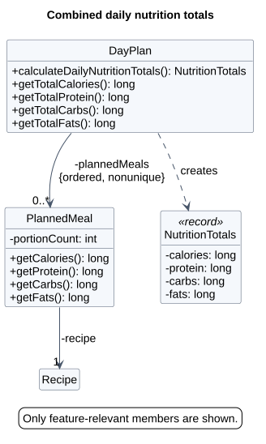

*Nutrition structure: `DayPlan` retains its ordered meals and creates an immutable totals value.
Only members used by this calculation are shown.*

`DayPlan.calculateDailyNutritionTotals()` returns one immutable `NutritionTotals` record containing
`calories()`, `protein()`, `carbs()`, and `fats()`. Calories are measured in kcal; the macronutrients
are measured in grams. It delegates to the existing individual total getters, giving callers a
single result without changing the plan, recipes, or the individual-getter API.

Every meal occurrence contributes its full nutrition, including repeated recipes. Each day is
calculated independently; these are not totals across the entire plan. An empty day returns four
zeros. All four record components use `long`, so sums of valid integer recipe values can exceed
`Integer.MAX_VALUE` without wrapping.

For example, a day containing the User Guide's Protein Oatmeal, Chicken and Rice, and Salmon Salad
has `new NutritionTotals(1650, 127, 150, 55)`. The record represents calculated data; it does not
apply target tolerance, validate a nutrition goal, or introduce a new console command. The existing
plan viewer computes its display totals from `MealSummary` values separately.

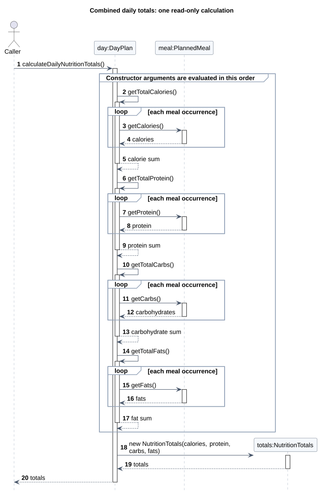

*Combined-total calculation: constructor arguments are evaluated in calories, protein, carbohydrates,
and fats order. Each existing getter traverses every meal occurrence using a `long` sum. Stream
internals are condensed, and the caller represents an API client rather than the plan viewer.*

`DayPlanTest` covers ordinary meals, one meal, zero nutrition, an empty day, repeated recipes,
independent days and repeated calls, unchanged meals, and totals above the integer range.

<!-- @@author -->

<!-- @@author oilybikechain -->
### Detecting exceeded nutrition targets

*Section author: oilybikechain*

The target-aware viewing structure is kept separate from the combined-totals model so both class
diagrams remain legible at guide width. The supplier interfaces are bindings of Java's existing
`Supplier` type; the dashed dependencies show the default lambdas reading current shared state.


`ActiveMealPlan` already retains the original `GeneratePlanRequest` alongside a generated plan for dietary
repair. Exceedance warnings reuse this request's immutable `NutritionTargets` rather than storing another
copy in `MealPlan`. Successful generation replaces both meals and targets through `setGenerated`; failed
generation preserves them. Dietary repair retains the request, and clearing a plan clears its request.
Legacy plans published with `set(MealPlan)` have no request and therefore no targets for warnings.

`NutritionTargets.calculateExcesses(NutritionTotals)` returns each nutrient's positive excess over its exact
target, or zero if the target is omitted or not exceeded. It uses `long` arithmetic, matching daily totals,
so sums beyond the integer range remain valid. This comparison does not use `TOLERANCE`: generation still
accepts days within ±15%, while viewing warns for any total strictly above the supplied target.

`Parser` supplies the current plan's meals and request targets to `ViewPlanCommand` at execution time.
Commands parsed before generation or replacement therefore display the latest meals and targets.
Legacy supplier-based parser and command constructors default to no targets. The new command constructor
accepts meal and target suppliers plus a nullable day number (null selects every day). The suppliers must
return corresponding meals and targets; omitted targets are represented by `NutritionTargets.none()`.

`MealPlanViewer` provides target-aware overloads for all days and one selected day; its original overloads
delegate with no targets. It sums each day's meals, requests excesses, and places warnings before the day's
closing separator in calories, protein, carbohydrates, and fats order. Warnings include the excess, actual
total, and target, using kcal for calories and g for the macronutrients. They do not change application state.
`check-shortfall` continues to use its explicitly supplied targets independently of this display.

State lookup and warning calculation are shown separately so their messages remain readable. The
first sequence follows a valid selected day: the default meal supplier adapts the current active plan,
then the target supplier reads the request stored with that plan.


The corresponding targets are read through a separate supplier after the selected day is known to
be valid.


With no active plan, execution returns before reading the target supplier. An out-of-range selected
day is also rejected before targets are read. For a valid selection, the viewer calculates and formats
warnings only for the displayed days.

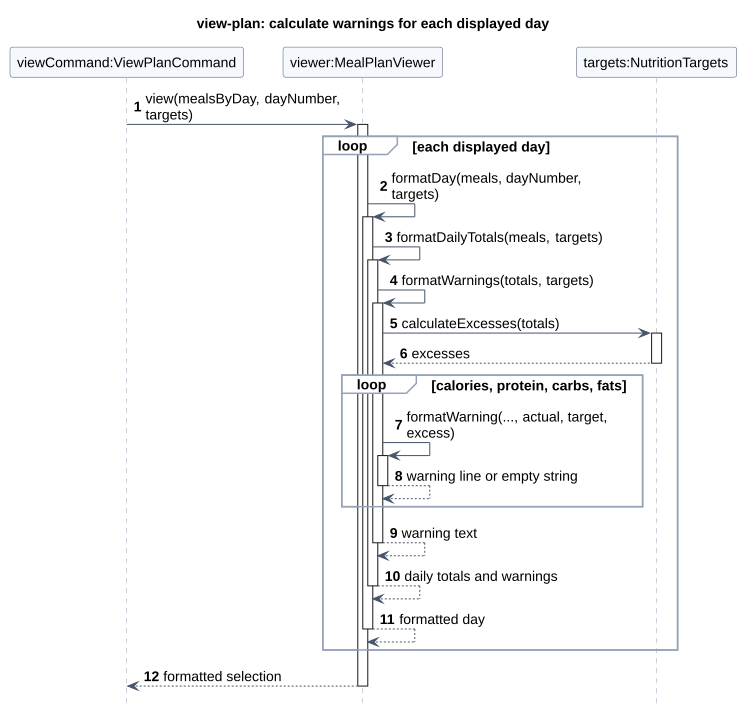

Tests cover exact comparison boundaries, omitted targets, simultaneous excesses, large totals, exact output,
and day selection. Integration tests verify the generation tolerance, replacement after success or failure,
legacy plans without requests, dietary repair and clearing, and independence from `check-shortfall`.
Run `gradlew.bat test checkstyleMain checkstyleTest` with Java 25.

<!-- @@author -->

<!-- @@author Rixte -->
### Checking nutrition shortfalls

*Section author: Rixte*

`check-shortfall` reports exact daily deficits against one or more explicit targets:

```text
check-shortfall [cal/DAILY_CALORIES] [p/DAILY_PROTEIN] [c/DAILY_CARBS] [f/DAILY_FATS]
```

For example, `check-shortfall cal/2000 p/100` checks only calories and protein. It checks
planned meals, rather than recorded meals, and does not save targets or rebalance the plan.
The [User Guide](UserGuide.md#checking-nutrition-shortfalls) gives examples and expected output.

#### Responsibilities

| Component | Responsibility |
| --- | --- |
| `Parser.parseCheckShortfall` | Coordinate parsing and attach command usage to validation errors. |
| `CheckShortfallParser` | Validate unique target tokens and create `NutritionTargets`. |
| `CheckShortfallCommand` | Read the current plan and report each day's deficits. |
| `DayPlan` | Supply the four existing nutrition totals as `long` values. |


*Selected stored references, with private role names and target multiplicities. The
ordered day list can hold repeated references. Parsing dependencies, recipe internals,
and the command interface are omitted.*
[PlantUML source](diagrams/rixte/shortfall/classes.puml)

The command retains the shared `ActiveMealPlan` and request-specific `NutritionTargets`.
The normal parser shares that holder with generation. Caller-provided viewing suppliers
do not replace this data source. The `RecipeBook` execution parameter is unused.

#### Parsing and daily comparison

`CheckShortfallParser` accepts each of `cal/`, `p/`, `c/`, and `f/` once, in any order.
Values must be digit strings representing 1 to `Integer.MAX_VALUE`; omitted nutrients
remain null. `Parser` wraps validation failures in `MishMashException`, preserving
their cause and attaching shortfall-specific usage.


*Successful execution for a plan containing days. One day's calorie lookup illustrates
the repeated comparison. Plan-size checks, target getters, `addShortfall`, report
assembly, and logging are condensed in the note.*
[PlantUML source](diagrams/rixte/shortfall/execution.puml)

1. `execute` reads the current plan; no plan or zero days returns generate-first guidance.
2. For each day, `findShortfalls` reads its calorie, protein, carbohydrate, and fat totals.
3. `addShortfall` appends `target - total` only when a target is supplied and the total is smaller.
4. Output lists each day's deficits, or states that the supplied targets have no shortfalls.

Comparisons use `long` totals and subtraction, so several large recipe values cannot
wrap into false deficits. Days are checked independently; a surplus on one cannot hide
another's deficit. Equality is sufficient, and omitted nutrients are ignored.

#### Errors and boundaries

| Condition | Result |
| --- | --- |
| No targets, unknown or repeated prefix, missing value, extra token, or space after a prefix | Reject before accessing the plan, with shortfall usage. |
| Zero, signed, negative, decimal, unit-suffixed, nonnumeric, or overflowing value | Reject; only positive whole numbers in range are accepted. |
| No active plan or zero days | Return `No active meal plan. Use 'generate-plan' first.` |
| A day contains no meals | Treat totals as zero; report each supplied target as its full deficit. |
| Target omitted or total at/above target | Add no deficit for that nutrient. |

Every check preserves the plan, generation settings, grocery snapshot, recipe book,
and saved personal targets.

#### Design choice and verification

Exact comparison explains the gap; the generator's +/-15% tolerance only decides whether
a candidate is acceptable. A 1900 kcal day can therefore satisfy generation for 2000 kcal
and still show a 100 kcal shortfall. Explicit targets allow a different comparison without
changing saved settings. Automatic rebalancing would need selection rules and grocery updates.

`CheckShortfallParserTest` and `ParserCheckShortfallTest` cover target orders, limits,
wrapped errors, and unchanged state after rejection. `CheckShortfallCommandTest`,
`CheckShortfallIntegrationTest`, and `CheckShortfallDiagnosticsTest` cover daily boundaries,
large totals, repeated execution, and snapshot preservation. Manually check a plan
against higher and lower targets, then use both viewing commands to confirm its data is unchanged.

<!-- @@author -->

<!-- @@author oilybikechain -->
### Generating a grocery list

*Section author: oilybikechain*

The grocery structure is divided by responsibility: command integration, source and snapshot state,
and aggregation values.

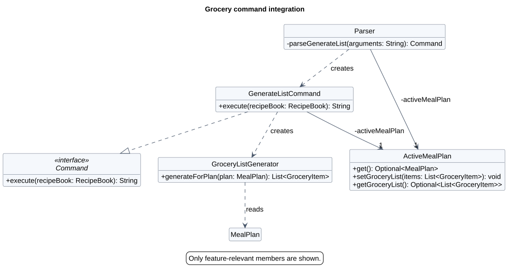

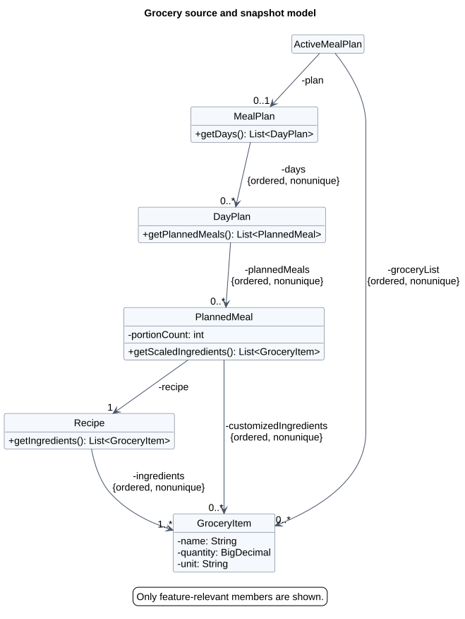

*Stored references and portions only; traversal methods are expanded in the collection sequence below.
Collection ends preserve order and allow repeated references. [PlantUML source](diagrams/oilybikechain/grocery-model-classes.puml).*

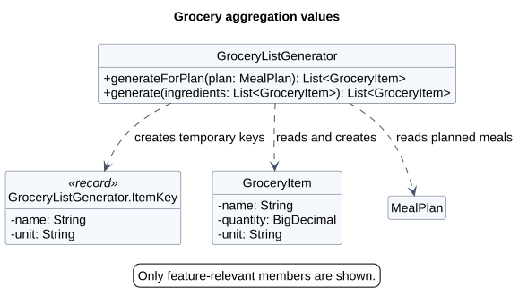

The parser and command retain the same active-plan holder. Plain navigable associations allow shared
model objects; they do not claim exclusive ownership. The optional grocery snapshot distinguishes an
absent snapshot from a present empty list. The temporary aggregation key is a dependency rather than
a stored generator field.

#### Ingredient aggregation

`GroceryItem` holds a trimmed, non-blank ingredient name and unit plus a nonnegative `BigDecimal`
quantity. Recipe input separately requires strictly positive ingredient quantities; zero is supported
by the grocery model and aggregation API. `toString()` uses plain decimal notation and removes
insignificant trailing zeros, for example `Oil: 0.3ml`.

`GroceryListGenerator.generate(List<GroceryItem>)` uses a `LinkedHashMap` keyed by an `ItemKey`
record containing the ingredient name and unit. Each occurrence is merged with `BigDecimal::add`.
Exact decimal addition avoids floating-point rounding, and insertion order preserves the first
appearance of each key. `Rice:200g` and `Rice:100g` combine; `Rice:1kg`, `rice:100g`, and
`Rice:1cups` remain separate. No unit conversion or spelling normalisation occurs. When groceries are
generated from a plan, `PlannedMeal` first scales each ingredient by its exact `BigDecimal` portion count.

The method rejects a null list or item, returns an empty list for empty input, and publishes an
unmodifiable result with `List.copyOf`. Inputs remain unchanged, and successive calls do not reuse
previous totals. `GroceryListGeneratorTest` checks exact matching, incompatible units, different
names, decimal precision, zero quantities, ordering, immutable output, repeated calls, and null inputs.

#### Command parsing and shared state

`Parser()` shares one `ActiveMealPlan` between meal-plan generation, grocery generation, and viewing. For deterministic tests or an externally managed plan, use `Parser(MealPlanGenerator, ActiveMealPlan)`. The supplier-based constructors retain their caller-provided viewing sources; their grocery viewers do not automatically read the internally generated grocery snapshot.

The parser accepts `generate-list` without arguments and returns `GenerateListCommand` without reading
or modifying the plan.


During execution, the command traverses `MealPlan.getDays()`, `DayPlan.getPlannedMeals()`, and each planned
meal's scaled ingredients. Every meal occurrence contributes its portion-adjusted quantities. `GroceryListGenerator`
combines exact name/unit matches with `BigDecimal` arithmetic, preserving first-appearance order and
keeping incompatible units separate.

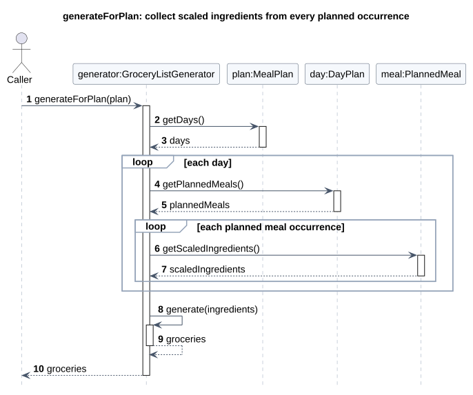

`ActiveMealPlan.setGroceryList` copies the completed result into a read-only snapshot. `getGroceryList` returns an optional: absence means no list has been generated for the current plan, whereas a present empty list is valid. `ViewListCommand` reads this snapshot during execution and delegates formatting to `GroceryListViewer`; viewing never regenerates data.

Successfully storing a replacement plan clears its old groceries. Failed plan generation or invalid command syntax leaves the previous state intact. The complete state is autosaved for later sessions.

The parse step rejects arguments with `generate-list does not accept arguments.` and
`Format: generate-list`; it does not inspect the active plan. The command reads the latest plan
when executed, so a command parsed before generation can use a subsequently generated plan. Without
a plan it returns `No active meal plan. Use 'generate-plan' first.` without publishing a snapshot.
Successful generation returns `Grocery list generated. Use 'view-list' to view it.` Only the finished
result is stored, preserving any previous snapshot if generation fails.

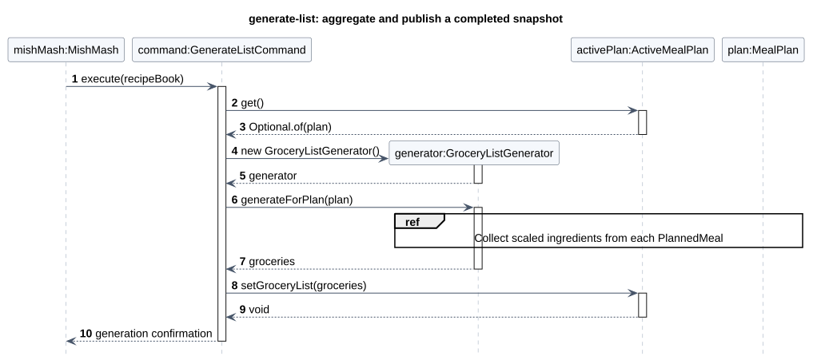

The execution sequence follows `executeWithResult`; `...` omits its `recipeBook` parameter.
The collection reference expands in the preceding `generateForPlan` sequence. Only a completed grocery
snapshot is published, and the command returns a `DONE` result. Autosaving follows the command result,
as shown under [Persistence and recovery](#persistence-and-recovery).
The [PlantUML source](diagrams/oilybikechain/grocery-execution.puml) keeps the publication sequence separate
from ingredient traversal so its labels remain readable at normal PDF width.
Ingredient-key lookup, decimal merging, and result-item construction happen inside
`GroceryListGenerator.generate` and are described in the ingredient-aggregation section above.

`GenerateListCommandTest`, `ParserGenerateListTest`, and `ActiveMealPlanTest` cover missing plans,
execution-time plan lookup, every recipe occurrence, repeated generation, syntax rejection, copying,
and snapshot replacement. `MishMashGeneratePlanTest` exercises the generation-to-viewing connection
through the console. Grocery-list formatting is supplied by the existing viewer rather than this
aggregation contribution.

Grocery parsing and viewing use `FINE` logs, successful generation logs counts at `INFO`, and rejected generation requests use `WARNING`. These loggers inherit the existing application configuration; no additional handlers are installed. New diagnostics exclude ingredient names and raw input.

Run `gradlew.bat test checkstyleMain checkstyleTest` on Windows with Java 25 to verify the integration.

#### Maintaining the grocery and nutrition diagrams

The class and sequence diagrams above have editable sources and regeneration instructions in
[`docs/diagrams/oilybikechain`](diagrams/oilybikechain/README.md). Generated SVGs are checked in under
`docs/images/oilybikechain`. Use Java 25 and PlantUML 1.2026.9 with the existing shared style and
Smetana class layout. Check method names, retained references, multiplicities, supplier indirection,
message order, and failure paths against current code, then syntax-check, render, and inspect every
image. Keep sources and SVGs synchronised. The [final integration review](diagrams/README.md#final-integration-review)
records owner evidence and both grocery readability decisions in the exported PDF. The contribution history identifies the relevant commits;
teammates' viewing, generation, formatting, and dietary components are shown as integration context.

<!-- @@author -->

<!-- @@author Rixte -->
### Viewing a grocery list

*Section author: Rixte*

`view-list` displays the grocery snapshot already created by `generate-list`. It accepts
no arguments and never aggregates ingredients itself. See the
[User Guide](UserGuide.md#viewing-a-grocery-list) for the output format.

#### Responsibilities

| Component | Responsibility |
| --- | --- |
| `Parser.parseViewList` | Reject arguments and inject the grocery supplier. |
| `ViewListCommand` | Read the current optional snapshot and distinguish absence from an empty list. |
| `GroceryListViewer` | Format items in supplied order, with `[ ]` markers and a total count. |

The normal parser supplies `activeMealPlan::getGroceryList`. The command retains the
supplier rather than a copied list, so later generation or reset is visible on execution.
Grocery aggregation and publication are covered in
[Grocery command integration](#generating-a-grocery-list).

#### Execution


*Both missing and generated snapshots are shown. A present empty list follows the
formatting branch; `items` is the list extracted from the present `Optional`. Supplier
holder access and item formatting are condensed; viewer construction is omitted.
The common return represents either guidance or the formatted list.*
[PlantUML source](diagrams/rixte/view-list/execution.puml)

1. `execute` calls `groceryListSource.get()` to read the latest snapshot.
2. An absent `Optional` returns `No grocery list generated. Use 'generate-list' first.`
3. A present list is passed to `GroceryListViewer.view`, including a list with zero items.

#### Errors and boundaries

| Condition | Result |
| --- | --- |
| Arguments supplied | Reject during parsing with view-list usage. |
| No generated snapshot | Show generate-list-first guidance without creating groceries. |
| Generated empty list | Display the normal heading and `Total items to purchase: 0`. |
| Successful `generate-plan` or `reset-plan` | The normal holder removes the old snapshot; later views show missing-list guidance. A successful `set-diet` repair regenerates an existing snapshot instead. |
| Null supplier result or null item | Throw `IllegalStateException` or `NullPointerException`; `MishMash.run` logs and rethrows the failure, ending the session. |

The viewer preserves item order, quantities, and units. Recipe edits or deletions do not
rewrite an existing snapshot; users regenerate the plan and groceries to incorporate them.

#### Design choice and verification

`Optional<List<GroceryItem>>` distinguishes "not generated" from "generated with no items".
Using an empty list for both would lose that distinction. Keeping generation separate
also lets users inspect the saved snapshot without silently replacing it.

`ViewListCommandTest`, `ViewListIntegrationTest`, `ViewListDiagnosticsTest`,
`GroceryListViewerTest`, and `ParserTest` check missing and empty snapshots,
execution-time lookup, formatting, invalid arguments, and preservation of recipes.
Manually generate groceries and view them twice. Then successfully run `generate-plan` or
confirm `reset-plan`; verify the next `view-list` asks for `generate-list`. To check the
different `set-diet` behaviour, generate groceries before changing the diet and verify that a
successful repair updates the existing grocery snapshot rather than showing missing-list guidance.

<!-- @@author -->

<!-- @@author GauthamNandi -->
### Recording meals and tracking nutrition

*Section author: GauthamNandi*

#### Purpose and scope

This V2.0 enhancement supports two user stories:

* **As a returning user, I want to record meals that I have eaten so that I can keep track of my
  actual food intake.**
* **As a user tracking nutrition, I want to calculate the total calories and macronutrients for each
  meal so that I know the nutritional content of what I am eating.**

It adds these commands:

```text
record-meal INDEX [date/YYYY-MM-DD] [s/SERVINGS]
view-meals [date/YYYY-MM-DD]
edit-meal MEAL_NUMBER [date/YYYY-MM-DD] [s/SERVINGS]
delete-meal MEAL_NUMBER
```

The date defaults to today and the servings default to 1. `MEAL_NUMBER` is a meal's position in the
whole log, as shown by `view-meals`.

`INDEX` is the position of a recipe in the `list-recipes` output, counting from 1, as for
`delete-recipe`. `view-meals` lists every recorded meal with its calories (kcal), protein, carbs and
fats (g), followed by the totals for all recorded meals. Unlike `check-shortfall`, which examines the
*planned* meals of the active plan, this feature records meals the user *has eaten*.
Recorded meals are retained as independent recipe snapshots across sessions.

A meal is a whole number of servings of a recipe, and a recipe stores the nutrition the user entered with
`add-recipe`; nutrition is not derived from ingredients. The nutritional content of one meal is therefore
its recipe's values multiplied by its servings. The feature calculates the totals across all recorded meals and shows them together with
each meal's stored nutrition values.

#### Architecture-level view

The feature follows the existing command workflow. `MishMash` reads input, asks `Parser` for a
`Command`, executes it, and prints the returned text. Parsing validates syntax and creates the action;
execution reads or changes session data. A new model class, `MealLog`, holds the recorded meals. Like
`ActiveMealPlan`, it is session data shared between commands, but it is separate from the plan: the plan
holds meals the user intends to eat, and the log holds meals the user has eaten.

The class diagrams separate command collaborators from stored model relationships.

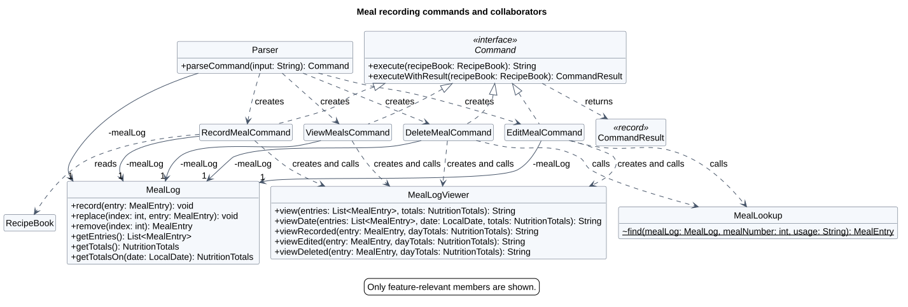

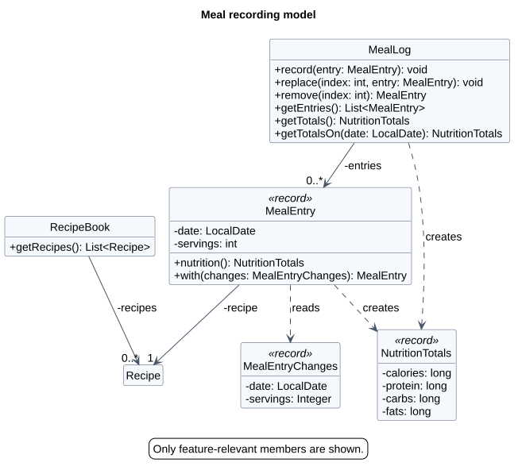

*Only members relevant to this enhancement are shown. Solid arrows are navigable
associations with private role names and multiplicities; dashed arrows with an open head show
dependencies, and dashed arrows with a hollow triangle show interface realization.
`NutritionTotals` is the existing value record that `DayPlan` also uses for daily totals, and `MealLog`
reuses it; its values are `long` so that adding many recipes cannot overflow.*

* `MealEntry` is an immutable record of a recipe, a date and a serving count, and its `nutrition()`
  multiplies the recipe's values by the servings. `MealEntryChanges` holds the optional typed date and
  servings, and `MealEntryParser` parses them for `record-meal` and `edit-meal`. It receives today's
  date as an argument, so tests can check future dates without depending on the system clock.
* `MealLog` stores the entries in the order they were recorded. It offers `record(...)`, `replace(...)`,
  `remove(...)`, read-only `getEntries()`, `getTotalsOn(date)` for one date, and
  `getTotals()`, which sums calories, protein, carbs and fats into a
  `NutritionTotals`, the same record `DayPlan` returns for a day's meals. The commands never add up nutrition values themselves.
* `RecordMealCommand`, `ViewMealsCommand`, `EditMealCommand` and `DeleteMealCommand` implement `Command`.
  Each retains the shared `MealLog`. `MealLookup` gives the last two the same checks on a meal number.
* `MealLogViewer` (ui) turns the meals and totals into text, in the same way
  `MealPlanViewer` formats a meal plan. Keeping formatting out of the model and commands lets them be
  tested without comparing layout text.
* `Parser` owns the `MealLog` and passes it to the commands it builds, because `Command.execute` only
  receives the `RecipeBook`. Every `Parser` constructor that is not given a log creates a fresh one, so
  isolated test sessions start with no recorded meals; production restores the saved log. `Parser(MealLog)` and
  `Parser(MealLog, MealPlanGenerator, ActiveMealPlan)` accept one, which lets tests supply and inspect
  the log. The command classes receive the log through their own constructors.

#### Recording a meal

Separate sequence diagrams show parsing and execution at a readable size. The parsing diagram
follows the successful parsing of `record-meal 2`; command dispatch is condensed into the parser
lifeline.

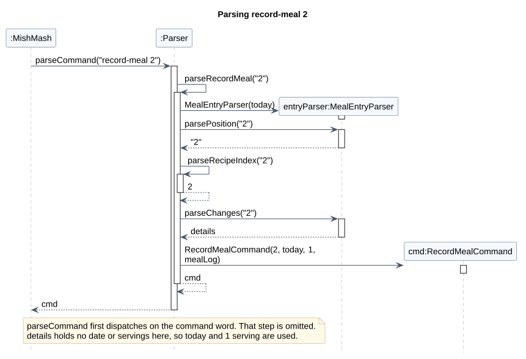

The execution diagram starts with the command returned by parsing and follows its successful execution.

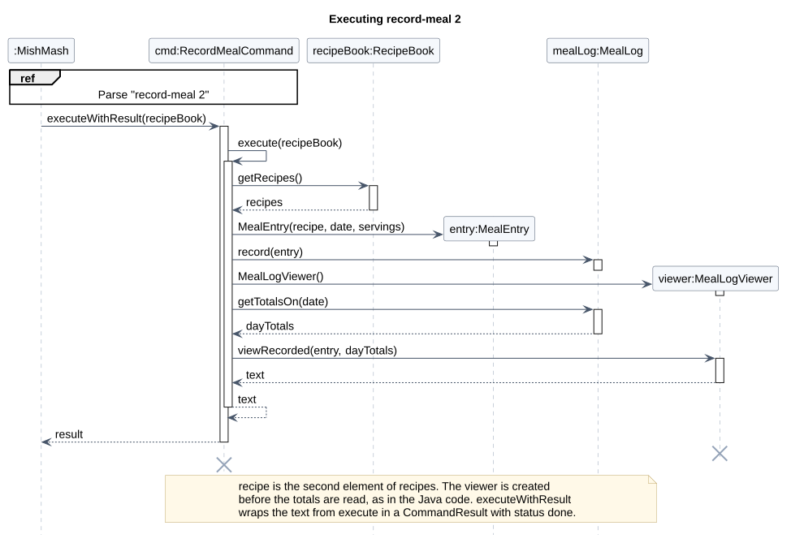

*Parsing returns a command without reading application data, and the execution diagram refers to it
with a `ref` frame. The inherited confirmation step is omitted because the command returns an empty
`Optional`. Invalid indexes are described below rather than combined with either successful
interaction. The `X` marks objects that are no longer used once the command has returned.*

`Parser` uses `MealEntryParser` to separate the index from the optional `date/` and `s/` fields, then
checks that the index is a single positive whole number. A missing, non-numeric, signed,
zero or extra argument is rejected with the `record-meal` usage line; nothing is read or
changed. The command is created only after validation succeeds.

During execution the command converts the index to a zero-based position, as `DeleteRecipeCommand`
does, and looks the recipe up in the `RecipeBook` passed to `execute`. If the book is empty or the index
exceeds the number of recipes, it throws a `MishMashException` and nothing is recorded. Otherwise it calls
`MealLog.record(entry)` with a new `MealEntry`, creates a `MealLogViewer`, reads `MealLog.getTotalsOn(date)`, and asks
`MealLogViewer.viewRecorded` to format the recorded meal's calories and macros with that date's totals,
so the user sees the effect immediately. The viewer is created before the totals are read because Java
evaluates the object a method is called on before that method's arguments.
Recording a meal needs no confirmation: it is quick to repeat, and it changes only the log.

#### Viewing recorded meals and totals

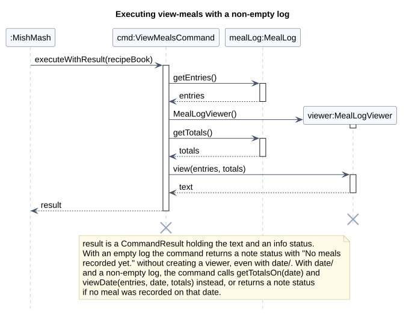

*Parsing mirrors `record-meal` and is omitted. The sequence follows a non-empty log; the
empty-log result is described below.*

`view-meals` accepts one optional `date/` field; anything else is rejected with its usage line. A date
keeps each meal's number from the whole log, so a number shown for one date works with `edit-meal` and
`delete-meal`. `ViewMealsCommand` reads
the entries from the `MealLog`. An empty log is a valid state, not an error, so the command returns
`No meals recorded yet.` Otherwise it creates a `MealLogViewer`, asks the log for the totals and delegates
formatting to the viewer. Each meal appears with its own calories and macros, followed by one totals line. If the
log is not empty but has no meals on a requested date, it returns `No meals recorded on DATE.` instead;
an empty log returns `No meals recorded yet.` even when `date/` is supplied. Viewing
never changes the log.

#### Correcting recorded meals

`edit-meal` and `delete-meal` find a meal by the number `view-meals` shows, using `MealLookup` so that both
report a bad number the same way. `EditMealCommand` builds a new `MealEntry` with `MealEntry.with(changes)`
and calls `MealLog.replace`, so the meal keeps its place and no other number changes. `DeleteMealCommand`
overrides `confirmationPrompt`, which also rejects a number that does not exist before the user is asked
anything, and then calls `MealLog.remove`; later meals move up by one. Both show the totals for the
affected date, and totals are recomputed from the log, so a correction cannot leave them out of step.
Editing needs no confirmation because it is easy to redo, whereas a deleted entry would have to be
recorded again.

#### Invalid input and recovery

The recoverable errors reuse the existing path: `Parser` or the command throws `MishMashException`,
`MishMash.executeCommand` catches it, displays the message, and prompts for another command.
The activity diagram shows where `record-meal` can be rejected; every rejection happens before the log changes.

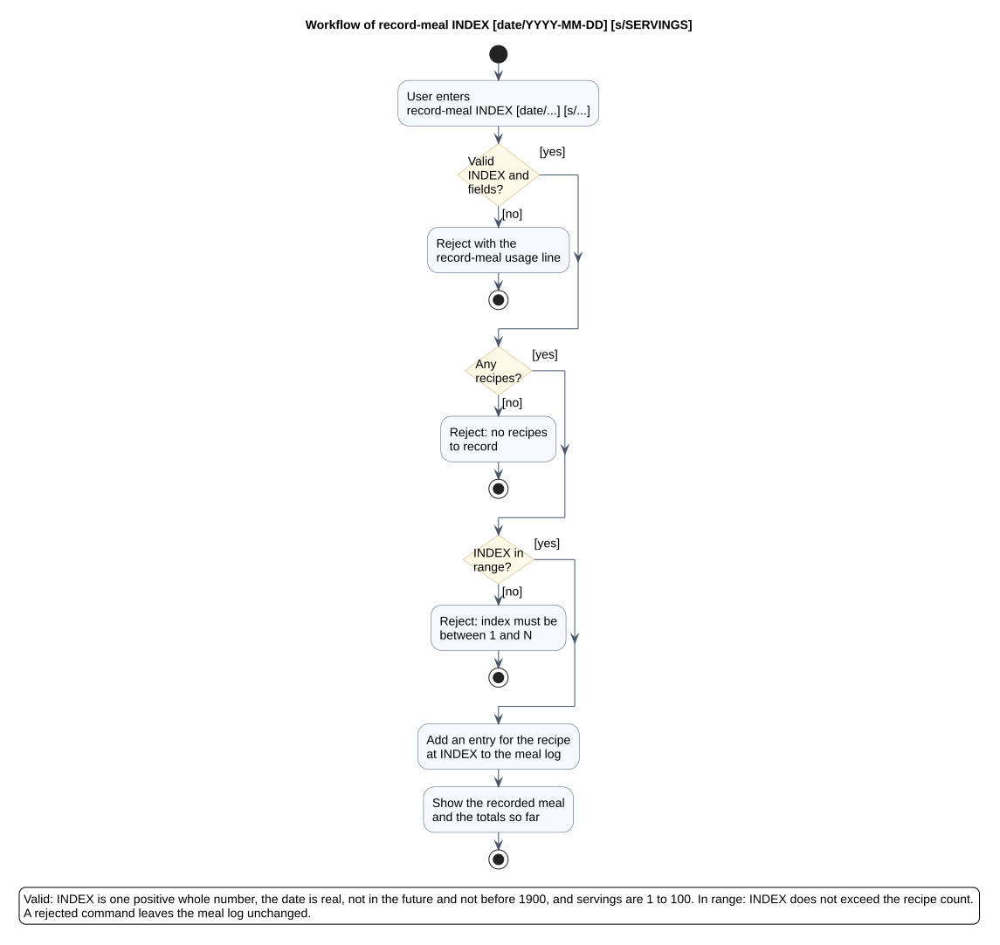

*Diamonds are decisions, with their guards in square brackets. The first decision is made by
`Parser`, the other two by `RecordMealCommand`.*

| Boundary or invalid condition | Behaviour |
| --- | --- |
| `record-meal` with no argument, a non-numeric, signed, zero or decimal index, or an extra token | Reject with the command format; no data is read or changed. |
| Index larger than the number of recipes | Reject with `Recipe index must be between 1 and N.`; nothing is recorded. |
| `record-meal` while the recipe book is empty | Reject with a message that there are no recipes to record; nothing is recorded. |
| `date/` that is not `YYYY-MM-DD` or is not a real date | Reject with the command format; nothing changes. |
| `date/` after today in `record-meal` or `edit-meal` | Reject, because a recorded meal has already been eaten. `view-meals` accepts any real date. |
| `s/` outside 1 to 100 | Reject with the command format; the limit catches typos and keeps totals within `long`. |
| `view-meals` with anything other than one `date/` | Reject with the command format. |
| `view-meals date/...` with no meals on that date | Return `No meals recorded on DATE.` |
| `edit-meal` with no field, or either correction command with a missing or invalid number | Reject with the command format; the log is unchanged. |
| `edit-meal` or `delete-meal` with a number beyond the log | Reject with `Meal number must be between 1 and N.`; `delete-meal` reports this before asking for confirmation. |
| `view-meals` before any meal is recorded | Return `No meals recorded yet.` |
| Recipe deleted, edited with `edit-recipe`, or otherwise changed after a meal was recorded | The recorded meal keeps its original calories and macros. |
| Same recipe recorded twice | Two entries are kept, and both count toward the totals. |
| Recipe with 0 g of protein, carbs and fats | The meal is recorded and contributes zeros for those nutrients. |

#### Rationale and alternatives considered

| Decision | Alternative considered | Reason for the current choice |
| --- | --- | --- |
| Store the `Recipe` itself in the log | Store the recipe's index | `Recipe` is immutable, so the log keeps the nutrition as it was when the meal was eaten. Indexes shift whenever `delete-recipe` runs, so an old entry could silently point to a different recipe. |
| `MealLog.getTotals()` sums the meals on every call | Keep running totals updated by `record` | The meal list is the single source of truth, so totals cannot drift out of step with it. Sessions are small, so the repeated sum costs nothing noticeable. Running totals would need extra care if removing meals is added later. |
| `Parser` owns the `MealLog` and passes it to the commands | Widen `Command.execute` to take a shared context object | `Parser` already owns and shares `ActiveMealPlan`, and this leaves the `Command` interface and every existing command unchanged. Constructors that take a `MealLog` let tests supply their own, as the `ActiveMealPlan` constructors do. A context object becomes worthwhile if many more data holders are added. |
| Pick a meal by recipe index | Type nutrition values in directly | Reusing stored recipes avoids duplicating the input and validation of `add-recipe` and keeps unchecked numbers out of the log. Free-text entry would help when eating out, so it is a possible extension. |
| Return formatted text through `Command.execute`, using a small viewer | Print from the command or the model | The viewer matches `MealPlanViewer` and keeps layout out of the logic, so the model and commands can be tested without comparing layout text. |

#### Limitations and possible extensions

* The log is autosaved and restored across application sessions, including dates and servings.
* A later version could compare a date's totals with the targets given to `check-shortfall`.
* `edit-meal` cannot change which recipe was eaten; deleting the entry and recording the right recipe
  does the same job.
* Servings are whole numbers, matching the whole-recipe portion counts of `adjust-portion`.

#### Verification

The feature is covered by `MealLogTest`, `MealEntryTest`, `MealEntryParserTest`,
`MealCorrectionCommandsTest`, `MealLogViewerTest`, `RecordMealCommandTest`,
`ViewMealsCommandTest`, `ParserRecordMealTest`, and console-workflow tests in `MishMashTest`. They check
the totals (including values beyond the `int` range), the exact output layout, every invalid index in
the table above, the empty-log
and empty-book cases, that failed commands leave the log unchanged, and that the log is separate from the
active plan. The manual checks are under [Record and View Meals](#record-and-view-meals); the use cases are
UC11, UC12, UC19 and UC20.

#### Diagram maintenance

The six editable diagram sources are under
[`docs/diagrams/gauthamnandi`](diagrams/gauthamnandi/README.md). Rendered SVGs are checked in under
`docs/images/gauthamnandi` so the diagrams display without a plugin. The source README gives the
regeneration commands. Check every depicted call, branch and message against the code after any change, and
update the sources and images together.


<!-- @@author -->

<!-- @@author peilingggg -->
### Command help

*Section author: peilingggg*

`HelpCommand` returns the supported command names, purposes, and formats to the application loop. Syntax constants are shared with parsers where available, reducing duplication when a command changes. The command does not read console input or change application data. Invalid commands are handled by the loop, which displays an error and allows another command. See the [User Guide help instructions](UserGuide.md#viewing-available-commands-help).


<!-- @@author -->

<!-- @@author Rixte -->
### Confirming plan changes

*Section author: Rixte*

Users confirm before an existing plan is cleared or replaced. This implements
[#61](https://github.com/AY2627S1-CS2113-W13-4/tp/issues/61). See the
[User Guide](UserGuide.md#confirming-plan-changes) for prompts and examples.

#### Responsibilities

| Component | Responsibility |
| --- | --- |
| `Parser` | Validate syntax and create a command before an answer can be requested. |
| `Command.confirmationPrompt` | Return an optional question based on current state, without changing it. |
| `MishMash` | Read the answer, skip cancelled commands, and display feedback or errors. |

#### Confirmation flow


*One shared flow covers acceptance, cancellation, and commands needing no answer.
Scanner operations, printing, and command internals are condensed.*
[PlantUML source](diagrams/rixte/confirm-plan/execution.puml)

1. `MishMash.executeCommand` parses the input, then calls `confirmationPrompt(recipeBook)`.
2. An empty `Optional` allows execution immediately. Otherwise `userConfirms` reads one line.
3. Only `y` or `yes`, ignoring case and surrounding spaces, permits `execute`. Other answers
   and EOF print `Cancelled. Nothing was changed.` and skip execution.

| Command | When a question is needed |
| --- | --- |
| `ResetPlanCommand` | A plan, generation request, or grocery snapshot exists, including an empty snapshot. |
| `GeneratePlanCommand` | A plan already exists. |
| `SetDietCommand` | An existing plan conflicts with the proposed preferences. |

#### Errors and boundaries

Invalid syntax is reported before confirmation. A command typed as an answer is consumed
as that answer; users must enter it again at the command prompt. Prompt lookup reads the
latest holder state and never generates replacements or changes preferences.

Agreement permits execution; it does not guarantee success. Failed replacement generation
preserves the previous plan and groceries. Dietary repair saves the new preferences even
when repair fails and clears the incompatible plan; its question explains that outcome.
Cancelling preserves the old preferences, plan, and groceries.

#### Reset activity


*This activity diagram starts after `reset-plan` arguments have been validated. Diamond
decision nodes and mutually exclusive guards show when confirmation is needed and when
execution is skipped. Answers are trimmed and compared without regard to case; EOF
follows the rejection branch. Cancellation preserves all session data. The execution
path assumes `clear()` and its postcondition checks succeed; recoverable failures are
described in the reset section instead of repeating them here. Recipes, preferences,
saved targets, and recorded meals are not modified.*
[PlantUML source](diagrams/rixte/confirm-plan/reset-activity.puml)

#### Design choice and verification

The existing confirmation hook keeps console input in `MishMash` and commands independently
testable. Putting a scanner inside every command would duplicate interaction logic. Direct
callers of `execute` must perform any required confirmation themselves. Feasibility checks
run after agreement, avoiding speculative generation and cached candidates during prompting.

`PlanConfirmationTest` covers accepted and rejected answers, EOF, invalid syntax,
execution-time state lookup, preservation after cancellation, and confirmed failures.
For a manual check, generate a plan and groceries, cancel `reset-plan`, and verify both
views are unchanged. Repeat with `yes` and verify both report missing data.

<!-- @@author -->

<!-- @@author oilybikechain -->
### Defensive checks and generation diagnostics

*Section author: oilybikechain*

`GeneratePlanCommand` retains an `IllegalArgumentException` as the cause when wrapping a generation
failure in `MishMashException`. Parser validation for `generate-plan`, `delete-recipe`, and
`list-recipes` likewise preserves the cause while adding the relevant command usage. Users receive
the existing recoverable error and can retry; developers can inspect the original exception through
`getCause()` or the application's rejection log. This does not add new command syntax.

After a failure, `GeneratePlanCommand` also asks `PlanFailureAdvisor` (logic) to explain it. If the dietary
preferences removed any recipes, the advisor reports how many remain. It then compares each target with the sum of the
three lowest and three highest values available, which proves cheaply that a target cannot be reached.
If every target passes that check, the targets conflict, so it suggests relaxing one. For recipe books
large enough to be sampled it also suggests retrying, because `MealPlanGenerator.checksEveryCombination`
is false and a valid combination could have been missed. The advice runs only on failure, so the
generator's selection rules do not change. The error shows the `generate-plan` usage rather than every
command, which keeps the advice visible. A more advanced alternative is to report the closest combination
found, but that would have to keep extra state during generation for a similar suggestion.

`MealPlanGenerator` uses assertions to check two internal invariants: the returned number of days
matches the request, and candidate construction starts with enough recipes. Normal argument validation
still handles user mistakes; assertions diagnose programming errors. Tests enable assertions through
the existing Gradle configuration. Enable them in a direct application run with
`java -ea -jar build/libs/MishMash.jar` when investigating invariants.

Generation logs at `FINE` record the requested day count, recipe count, whether targets were supplied,
and how many candidate combinations matched. They use the existing logger configuration and do not
record recipe contents. `ParserTest.parseCommand_invalidArguments_preservesCauseAndUsage` checks
the cause and usage for all three parsing paths; `GeneratePlanCommandTest` verifies the original
generation cause is retained. These changes strengthen diagnostics around teammates' commands rather
than implementing those commands.

The validation and application-recovery interactions are separate so their exception returns and
activation bars remain clear.


`generate-plan d/0` fails while parsing, so no command is constructed or executed. The outer
exception retains the validation cause. `MishMash` then logs the rejection, displays the recoverable
error, and prompts for another command.

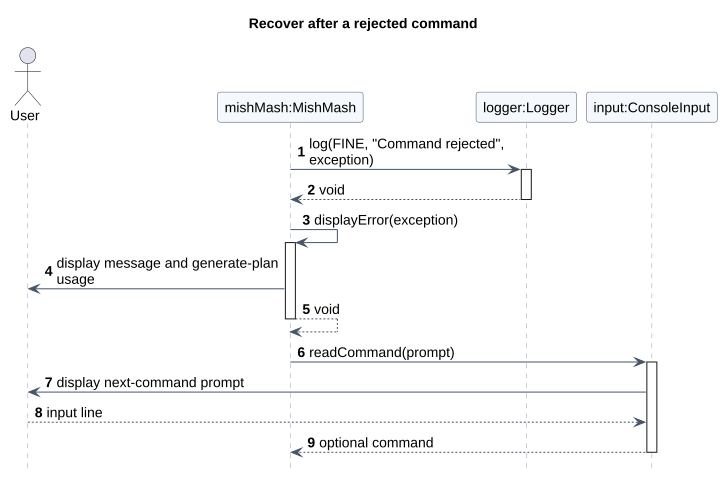

<!-- @@author -->

<a id="documentation-logging-testing-configuration-and-devops"></a>

## Documentation, logging, testing, dev-ops

### Documentation

The project documentation is maintained in Markdown under `docs`. The main documents are `DeveloperGuide.md` and `UserGuide.md`

Keep command formats, examples, prerequisites, and expected results consistent with the code. Document planned behaviour separately from available behaviour.

For RepoSense attribution and corrections, see [Contributing to MishMash](Contributing.md#claiming-and-correcting-authorship-with-reposense).

### Logging

The application uses `java.util.logging`. Diagnostics are written to rotating files using the pattern `mishmash.%g.log`, with an approximate limit of 1,000,000 bytes per file and three files retained.

Levels include `FINE` for command diagnostics, `INFO` for lifecycle events and successful grocery-generation counts, `WARNING` for selected rejected operations or logging problems, and `SEVERE` for unexpected application failures. If the log file cannot be opened because of an I/O error, the application continues with its existing logging configuration.

### Testing

The project uses JUnit Jupiter. Tests are under `src/test/java/mishmash` and mirror the production packages. They cover validation, commands, models, generation, display formatting, and full console interactions.

JLine's automated UI tests also belong in this JUnit suite. `ui/JLineConsoleInputTest` exercises real
in-memory editing and uses a scripted reader for interrupt/EOF handling. `ui/CommandCompleterTest` covers
command and prefix suggestions, while `ui/ConsoleInputsTest` covers adapter selection and fallback.
`JLineSessionTest` is an integration test: it runs application commands, confirmations, and meal corrections
through the real JLine input adapter. These tests do not require native console access. Actual terminal
display, native-provider initialisation, and platform key sequences still need the
[manual terminal checklist](#interactive-command-entry).

Run verification from the repository root:

```powershell
.\gradlew.bat check jacocoTestReport
```

On Linux or macOS:

```text
./gradlew check jacocoTestReport
```

Use Java 25. JUnit reports appear at `build/reports/tests/test/index.html`, and Checkstyle reports are under `build/reports/checkstyle`. JaCoCo HTML coverage is at `build/reports/jacoco/test/html/index.html`. The `check` task includes tests, Checkstyle, and a coverage gate requiring 100% line and branch coverage for `ResetPlanCommand`, `GeneratePlanCommand`, and `SetDietCommand`; this is not a project-wide 100% requirement. `jacocoTestReport` generates the report separately. Tests enable assertions, and packaged-JAR storage tests use temporary working directories.

The add-recipe invalid-input dataset is `src/test/resources/add-recipe-invalid.tsv`.

### Configuration

The current application has no user configuration file. Users supply recipe values, plan length, and optional daily nutrition targets through commands.

The supported plan length is 1 to 7 days. Each generated day contains exactly three different stored recipe entries. Generation uses a fixed target tolerance of 15%; users cannot change that tolerance through a command. In contrast, `check-shortfall` reports any amount strictly below the explicit targets supplied to that check.

### DevOps

GitHub Actions runs `./gradlew check` for pushes and pull requests on Ubuntu, macOS, and Windows using Java 25. Check the resulting reports before merging changes.

The Gradle build packages the application as `build/libs/MishMash.jar`. Release documentation should use that filename and describe the features included in the actual release.

## Appendix A: Product Scope

**Target user profile:** Users who prepare meals in advance, want to organise recipes and review calorie or macronutrient totals, and are comfortable entering text commands. Users provide their own recipes and nutrition information.

**Value proposition:** MishMash connects recipe management, meal selection, and grocery preparation in one workflow. It generates plans from user-entered recipes and combines ingredient quantities for the selected meals.

**Current boundaries:** Data is retained locally across sessions. Nutrition is entered by the user rather than calculated from an ingredient database, including after occurrence-specific ingredient customisation. Plans support positive whole-recipe portion counts, not fractional servings. Ingredient names and units are matched exactly; automatic unit conversion and grocery-item ticking are not supported.

## Appendix B: User Stories

Priorities follow the AB3 convention: `***` essential, `**` useful, `*` optional. Grey rows are the v1.0 MVP; green rows are the v2.0 MVP. Text labels retain that meaning when colour is unavailable. Owners identify the feature contributors; the v2.0b and v2.1 owners are based on the authors of the merged feature PRs in the team repository. Uncoloured rows cover implemented v2.0b and v2.1 stories. Release labels follow the [team milestones](https://github.com/AY2627S1-CS2113-W13-4/tp/milestones).

<table>
<thead><tr><th>Release</th><th>Priority</th><th>As a ...</th><th>I want to ...</th><th>So that I can ...</th><th>Owner</th><th>Current support</th></tr></thead>
<tbody>
<tr style="background-color: #e6e6e6; color: #111111;"><td>v1.0 MVP</td><td>***</td><td>Meal prep user</td><td>Add a recipe</td><td>Use my own dishes in meal plans</td><td>Pei Ling</td><td><code>add-recipe</code></td></tr>
<tr style="background-color: #e6e6e6; color: #111111;"><td>v1.0 MVP</td><td>***</td><td>User managing recipes</td><td>Delete a recipe</td><td>Remove dishes I no longer need</td><td>Neil</td><td><code>delete-recipe</code></td></tr>
<tr style="background-color: #e6e6e6; color: #111111;"><td>v1.0 MVP</td><td>***</td><td>User managing recipes</td><td>List recipes and inspect one recipe</td><td>Choose a dish and check its details</td><td>Neil</td><td><code>list-recipes [INDEX]</code></td></tr>
<tr style="background-color: #e6e6e6; color: #111111;"><td>v1.0 MVP</td><td>***</td><td>Meal prep user</td><td>Generate a random meal plan</td><td>Reduce manual meal selection</td><td>Gautham</td><td><code>generate-plan</code></td></tr>
<tr style="background-color: #e6e6e6; color: #111111;"><td>v1.0 MVP</td><td>***</td><td>Shopper</td><td>Generate a grocery list</td><td>Obtain combined ingredient quantities for my plan</td><td>Justin</td><td><code>generate-list</code></td></tr>
<tr style="background-color: #e6e6e6; color: #111111;"><td>v1.0 MVP</td><td>***</td><td>Shopper</td><td>View the grocery list</td><td>See what to purchase</td><td>Samantha</td><td><code>view-list</code></td></tr>
<tr style="background-color: #e6e6e6; color: #111111;"><td>v1.0 MVP</td><td>***</td><td>Meal prep user</td><td>View my meal plan</td><td>Review the meals selected for each day</td><td>Samantha</td><td><code>view-plan</code></td></tr>
<tr style="background-color: #d9ead3; color: #111111;"><td>v2.0 MVP</td><td>***</td><td>User with dietary requirements</td><td>Set dietary preferences and restrictions</td><td>Generate meals compatible with my declared requirements</td><td>Pei Ling</td><td><code>set-diet</code></td></tr>
<tr style="background-color: #d9ead3; color: #111111;"><td>v2.0 MVP</td><td>***</td><td>New user</td><td>Receive assistance from a help command</td><td>Find available commands and their formats</td><td>Pei Ling</td><td><code>help</code></td></tr>
<tr style="background-color: #d9ead3; color: #111111;"><td>v2.0 MVP</td><td>***</td><td>User tracking nutrition</td><td>Set a daily calorie target</td><td>Plan toward my desired calorie intake</td><td>Neil</td><td><code>set-targets cal/...</code></td></tr>
<tr style="background-color: #d9ead3; color: #111111;"><td>v2.0 MVP</td><td>***</td><td>User tracking nutrition</td><td>Set daily macronutrient targets</td><td>Plan toward my protein, carbohydrate, and fat goals</td><td>Neil</td><td><code>set-targets p/... c/... f/...</code></td></tr>
<tr style="background-color: #d9ead3; color: #111111;"><td>v2.0 MVP</td><td>***</td><td>User tracking intake</td><td>Record meals eaten</td><td>Keep track of my actual food intake</td><td>Gautham</td><td><code>record-meal</code></td></tr>
<tr style="background-color: #d9ead3; color: #111111;"><td>v2.0 MVP</td><td>***</td><td>User tracking nutrition</td><td>Calculate nutrition totals for each meal</td><td>Review each recorded meal's calories and macronutrients</td><td>Gautham</td><td><code>view-meals</code></td></tr>
<tr style="background-color: #d9ead3; color: #111111;"><td>v2.0 MVP</td><td>***</td><td>User tracking nutrition</td><td>Calculate daily nutrition totals</td><td>Review the combined nutrition of each planned day</td><td>Justin</td><td><code>view-plan</code> for planned days; <code>view-meals date/YYYY-MM-DD</code> for recorded daily totals</td></tr>
<tr style="background-color: #d9ead3; color: #111111;"><td>v2.0 MVP</td><td>***</td><td>User tracking nutrition</td><td>Detect meal plans that exceed nutrition targets</td><td>Identify days above my exact generation targets</td><td>Justin</td><td><code>view-plan</code> warnings</td></tr>
<tr style="background-color: #d9ead3; color: #111111;"><td>v2.0 MVP</td><td>***</td><td>User tracking nutrition</td><td>Detect meal plans that fall short of nutrition targets</td><td>Identify deficits against the targets I supply</td><td>Samantha</td><td><code>check-shortfall</code></td></tr>
<tr style="background-color: #d9ead3; color: #111111;"><td>v2.0 MVP</td><td>***</td><td>User managing recipes</td><td>Edit an existing recipe</td><td>Keep its details consistent with how I prepare it</td><td>Samantha</td><td><code>edit-recipe</code></td></tr>
<tr><td>v2.0b</td><td>**</td><td>Returning user</td><td>Reset my active plan and groceries</td><td>Start again while keeping recipes, settings, and intake records</td><td>Samantha</td><td><code>reset-plan</code></td></tr>
<tr><td>v2.0b</td><td>**</td><td>Meal prep user</td><td>Customise one planned meal's ingredients</td><td>Adapt one occurrence without editing its source recipe</td><td>Justin</td><td><code>customize-meal</code>; nutrition is not recalculated from ingredients</td></tr>
<tr><td>v2.0b</td><td>**</td><td>Returning user</td><td>Confirm plan removal or replacement</td><td>Avoid accidentally losing my plan</td><td>Samantha</td><td>confirmation before reset, replacement generation, and incompatible dietary changes</td></tr>
<tr><td>v2.0b</td><td>**</td><td>User with dietary requirements</td><td>View my dietary settings</td><td>Check which restrictions apply</td><td>Pei Ling</td><td><code>view-diet</code></td></tr>
<tr><td>v2.1</td><td>**</td><td>Returning user</td><td>Retain my data between sessions</td><td>Continue planning after restarting</td><td>Justin</td><td>local JSON autosave, restoration, backup recovery, and process locking</td></tr>
<tr><td>v2.1</td><td>**</td><td>Meal prep user</td><td>Replace an individual planned meal</td><td>Adapt the plan to what I want to eat</td><td>Neil</td><td><code>replace-meal</code>; one portion, source ingredients, and current dietary checks</td></tr>
<tr><td>v2.1</td><td>**</td><td>Meal prep user</td><td>Adjust a planned meal's portion</td><td>Scale nutrition and groceries to my intended quantity</td><td>Justin</td><td><code>adjust-portion</code>; positive whole-recipe portions only</td></tr>
<tr><td>v2.1</td><td>**</td><td>Meal prep user</td><td>Understand unsuccessful plan generation</td><td>Know what to change before retrying</td><td>Gautham</td><td>generation failure advice for eligible recipes and nutrition targets</td></tr>
<tr><td>v2.1</td><td>**</td><td>User tracking intake</td><td>Review recorded meals by date</td><td>Understand intake for a selected day</td><td>Gautham</td><td>dated records, servings, and <code>view-meals date/YYYY-MM-DD</code></td></tr>
<tr><td>v2.1</td><td>**</td><td>User tracking intake</td><td>Correct or remove recorded meals</td><td>Keep intake records accurate</td><td>Gautham</td><td><code>edit-meal</code> and confirmed <code>delete-meal</code></td></tr>
<tr><td>v2.1</td><td>**</td><td>User with dietary requirements</td><td>Clear my dietary restrictions</td><td>Generate without restrictions</td><td>Justin</td><td><code>clear-diet</code></td></tr>
<tr><td>v2.1</td><td>**</td><td>CLI user</td><td>Edit commands and use completion and history</td><td>Enter long commands more easily</td><td>Samantha</td><td>JLine editing, Tab completion, in-memory history, and plain-input fallback</td></tr>
</tbody>
</table>

### Use cases

The actor is a user who has started a session and entered a name. MSS means Main Success Scenario.

**Shared rules**

- Invalid syntax or values produce command-specific error/usage feedback, preserve existing data, and allow another command.
- Viewing and checking commands do not mutate application data.
- Confirmation accepts only `y` or `yes`, ignoring case and surrounding whitespace. Any other answer, a blank
  answer, or EOF cancels without applying the pending change. EOF from piped or redirected input also ends
  the session. In interactive editing, Ctrl+D at an empty confirmation cancels the action and returns to the
  command prompt.
- Each MSS ends after its final step. Each extension ends the use case after its stated response unless it explicitly resumes an MSS step. The session then accepts another command, except after exit/EOF.

#### UC01 Add a recipe

**MSS**

1. The user enters `add-recipe` with a name, nutrition values, and at least one ingredient.
2. MishMash validates the input.
3. MishMash adds the recipe and displays its details.

**Extensions**

- 2a. A field is missing, blank, repeated, or invalid: reject the addition.

#### UC02 List recipes

**MSS**

1. The user enters `list-recipes`, optionally selecting an index.
2. MishMash displays the numbered names and calories of all recipes, or the full details of the selected recipe.

**Extensions**

- 1a. The index syntax is invalid: reject the command.
- 2a. The book is empty: MishMash displays guidance to add a recipe.
- 2b. The selected index does not exist: MishMash displays an index-range error.

#### UC03 Delete a recipe

**MSS**

1. The user enters `delete-recipe INDEX`.
2. MishMash checks the index and asks for confirmation, naming the selected recipe.
3. The user enters `y` or `yes`.
4. MishMash deletes the entry and displays its name and the remaining recipe count.

**Extensions**

- 1a. The index syntax is invalid: MishMash displays an error.
- 2a. The book is empty or the index does not exist: reject before confirmation.
- 3a. Confirmation is declined: cancel deletion.

#### UC04 Generate a meal plan

**MSS**

1. The user enters `generate-plan d/DAYS`, optionally including daily nutrition targets.
2. MishMash validates the requested days and targets.
3. If a plan is already active, MishMash asks whether to replace it and clear its groceries; the user confirms.
4. MishMash generates exactly three different recipe entries per day, meeting every applied target within 15%.
5. MishMash makes the new plan active, clears the previous groceries, and displays a confirmation.

**Extensions**

- 2a. Days are outside 1 to 7, a target is not a positive integer, or arguments are malformed: MishMash rejects the command.
- 3a. Confirmation is declined: cancel replacement.
- 4a. Fewer than three recipe entries are available, or no acceptable plan is found: MishMash displays an error, the likely cause, and what to try next. The previous plan and groceries remain available.

Recipes may be repeated on different days. With no targets, there are no nutrition constraints on the selection. Targets saved with `set-targets` (UC13) apply to every nutrient that the command leaves out, and a target typed in the command replaces the saved one for that plan.

#### UC05 View a meal plan

**MSS**

1. The user enters `view-plan`, optionally selecting `d/DAY_NUMBER`.
2. MishMash displays all days or the selected day, including each meal's nutrition and daily totals.

**Extensions**

- 1a. The day argument is malformed: reject the command.
- 2a. No plan is active: MishMash asks the user to generate one first.
- 2b. The selected day exceeds the active plan's length: MishMash displays a range error.

#### UC06 Generate a grocery list

**MSS**

1. The user enters `generate-list` without arguments.
2. MishMash combines ingredients from every meal occurrence in the active plan.
3. MishMash stores the completed groceries and confirms that they can be viewed using `view-list`.

**Extensions**

- 1a. Arguments are supplied: MishMash rejects the command without changing the stored list.
- 2a. There is no active plan: MishMash asks the user to generate one first.

Only exact ingredient-name and unit matches are combined. Different units or letter case remain separate entries.

#### UC07 View a grocery list

**MSS**

1. The user enters `view-list` without arguments.
2. MishMash displays the stored entries, their quantities and units, and the total number of entries.

**Extensions**

- 1a. Arguments are supplied: MishMash displays an error.
- 2a. No grocery list has been generated: MishMash asks the user to generate one first.

Viewing does not regenerate groceries. The displayed `[ ]` markers cannot be ticked through a command.

#### UC08 View help or exit

- Entering `help` displays command purposes and formats. Additional arguments produce an error.
- Entering `bye` displays the goodbye message and ends the session. The latest successfully saved user data is retained.

<!-- @@author Rixte -->
#### UC09 Check planned nutrition shortfalls

**MSS**

1. The user enters `check-shortfall` with at least one daily nutrition target.
2. MishMash validates the target arguments and obtains the active plan.
3. MishMash compares each day's planned totals with the supplied targets.
4. MishMash displays each day's deficient nutrients and amounts, or a no-shortfalls
   message for that day.

**Extensions**

- 2a. Targets are missing, repeated, unknown, or invalid: reject the check.
- 2b. No plan exists or the plan has no days: ask the user to generate a plan.

Omitted nutrients and excesses are not checked. All plan, recipe, and grocery data remains
unchanged. A shortfall is any amount below a target, even within generation's tolerance.

<!-- @@author -->
<!-- @@author oilybikechain -->
#### UC10 Detect exceeded nutrition targets

**MSS**

1. The user enters `view-plan`, optionally selecting a day.
2. MishMash calculates each displayed day's nutrition totals and compares them with the saved generation targets.
3. For each exceeded target, MishMash displays a warning with the excess, actual total, and target below that day's totals.

**Extensions**

- 2a. A target is omitted, equal to the total, or above it: skip that nutrient and resume step 3 for the remaining nutrients.
- 2b. No generation request is retained, or the plan was generated without targets: only the normal plan display is shown.
- 2c. No plan exists or a selected day is invalid: the existing `view-plan` messages apply.

The comparison is strict and does not apply the generator's 15% tolerance. Viewing leaves the meals,
targets, and groceries unchanged. A successful replacement uses its new targets; failed generation
preserves the previous warnings. Dietary repair recalculates warnings using the repaired meals and
the retained generation targets. Clearing the plan removes the warnings.

<!-- @@author -->
<!-- @@author GauthamNandi -->
#### UC11 Record a meal eaten

**MSS**

1. The user enters `record-meal INDEX`, using an index shown by `list-recipes`, optionally with a date and servings.
2. MishMash validates the input and finds the recipe at that position.
3. MishMash adds the recipe, date and servings to the recorded meals. The date defaults to today and the servings default to 1.
4. MishMash displays the meal and the totals of all recorded meals.

**Extensions**

- 2a. The index is missing or is not a single positive whole number, or the date or servings are invalid: reject without recording.
- 2b. There are no recipes, or the index is larger than the number of recipes: reject without recording.

No confirmation is requested. Recording changes only the recorded meals; recipes, the meal plan, and groceries are unchanged. Recording the same recipe again adds another entry.

#### UC12 View recorded meals

**MSS**

1. The user enters `view-meals`, optionally with a date.
2. MishMash reads the recorded meals and sums their nutrition, for that date if one was given.
3. MishMash displays each meal in the order recorded with its calories, macronutrients, servings and date, followed by the totals.

**Extensions**

- 1a. The user adds anything other than one valid date: reject the command.
- 2a. No meal has been recorded: display `No meals recorded yet.`
- 2b. No meal was recorded on the given date: display `No meals recorded on DATE.`

Without a date, the totals cover every retained recorded meal.

<!-- @@author -->
<!-- @@author neil0618 -->
#### UC13 Set daily targets

**MSS**

1. The user enters `set-targets` with one or more of `cal/`, `p/`, `c/`, and `f/`, each followed by a positive whole number or `none`.
2. MishMash validates every argument.
3. MishMash replaces the target of each nutrient given a number, removes the target of each nutrient given `none`, and keeps the targets of the other nutrients.
4. MishMash displays the targets now saved, or `All daily targets cleared.` if none remain.

**Extensions**

- 2a. No argument is given, a prefix is unknown or repeated, a value is missing, or a value is neither `none` nor a positive whole number up to 2147483647: reject the update.
- 3a. The result equals the targets already saved: display `Daily targets are unchanged. Nothing was changed.` and save nothing.

The command does not change the recipe book or an existing meal plan. The saved targets are used by later `generate-plan` commands (UC04) and remain available after restarting from the same working directory.

#### UC14 View daily targets

**MSS**

1. The user enters `view-targets`.
2. MishMash displays the saved target of each nutrient, with `not set` for a nutrient that has none.

**Extensions**

- 1a. The user adds an argument: reject the command.
- 2a. No target is saved: display `No daily targets saved. Use 'set-targets' to set them.`

<!-- @@author -->
<!-- @@author peilingggg -->
#### UC15 Set dietary preferences

**MSS**

1. The user enters `set-diet` with at least one supported prefixed field.
2. MishMash validates the complete replacement profile.
3. If any planned day conflicts, MishMash asks for confirmation. After agreement, it preserves compatible planned days and replaces conflicting days using the original targets.
4. MishMash rebuilds existing groceries after repair, saves the profile, and displays the outcome.

**Extensions**

- 2a. Syntax or values are invalid: reject the command.
- 3a. No active plan exists: save the profile for future generation and display the outcome.
- 3b. The complete plan is compatible: save the profile, preserve the plan and groceries, and display the outcome.
- 3c. The user declines confirmation: preserve the profile, plan, and groceries.
- 3d. Replacement fails or the original request is unavailable: save the profile, clear
  the plan and groceries, and explain how to generate again.

#### UC16 View dietary preferences

**MSS**

1. The user enters `view-diet` without arguments.
2. MishMash reads the current session profile and displays the diet and both exclusion lists.

**Extensions**

- 1a. Arguments are supplied: reject the command.
- 2a. No restrictions are active: display `none` for the diet and both lists.

<!-- @@author -->

#### UC17 Clear dietary preferences

**MSS**

1. The user enters `clear-diet` without arguments.
2. MishMash resets the complete dietary profile to unrestricted and displays confirmation.
3. MishMash preserves recipes, the active plan and its customisations, groceries, saved targets,
   and recorded meals.

**Extensions**

- 1a. Arguments are supplied: reject the command.
- 2a. The profile is already unrestricted: report that nothing changed and preserve all data.

#### UC18 Edit a recipe

**MSS**

1. The user lists recipes and chooses an index.
2. The user enters `edit-recipe INDEX` with at least one replacement field.
3. MishMash validates the input, replaces the recipe at that index, and displays its updated details.

**Extensions**

- 2a. The index or a supplied field is invalid, or no edits are supplied: reject the edit.

Existing meal plans and recorded meals keep their previous recipe snapshots.

<!-- @@author GauthamNandi -->
#### UC19 Correct a recorded meal

**Precondition:** At least one meal has been recorded.

**MSS**

1. The user enters `edit-meal MEAL_NUMBER` with a new date, new servings or both, using a number shown by `view-meals`.
2. MishMash validates the input and replaces the meal, keeping its number.
3. MishMash displays the corrected meal and the totals for its date.

**Extensions**

- 1a. The number or a supplied field is invalid, or no field is supplied: reject the correction.
- 2a. The number is larger than the number of recorded meals: reject the correction.

#### UC20 Delete a recorded meal

**Precondition:** At least one meal has been recorded.

**MSS**

1. The user enters `delete-meal MEAL_NUMBER`, using a number shown by `view-meals`.
2. MishMash describes the meal and asks for confirmation.
3. The user confirms.
4. MishMash removes the meal, moves later meals up by one, and displays the deleted meal and the totals remaining for its date.

**Extensions**

- 1a. The number is missing, invalid or larger than the number of recorded meals: reject before confirmation.
- 3a. The user does not confirm: cancel deletion.

<!-- @@author -->

#### UC21 Reset the active plan

**MSS**

1. The user enters `reset-plan`.
2. MishMash asks for confirmation when plan state exists.
3. The user confirms with `y` or `yes`.
4. MishMash clears the plan, retained generation request, and groceries, preserving recipes, dietary settings, saved targets, and recorded meals.

**Extensions**

- 1a. Arguments are supplied: reject the command.
- 2a. No plan state exists: report that there is no active plan to reset.
- 3a. Confirmation is declined: cancel reset.

#### UC22 Adjust a planned meal's portions

**MSS**

1. The user enters `adjust-portion d/DAY m/MEAL portions/COUNT`.
2. MishMash validates the positions and positive whole-recipe portion count.
3. MishMash updates only that occurrence, scales its nutrition and ingredient quantities, and clears existing groceries.

**Extensions**

- 2a. No plan exists: ask the user to generate one first.
- 2b. Syntax, positions, count, or resulting totals are invalid: reject the change.
- 3a. The count is unchanged: report a no-op and preserve groceries.

The source recipe, other occurrences, saved targets, dietary profile, and recorded meals are unchanged. Run `generate-list` to obtain updated groceries.

#### UC23 Customise a planned meal's ingredients

**MSS**

1. The user enters `customize-meal d/DAY m/MEAL i/INGREDIENT:QUANTITYUNIT`, repeating `i/` for the complete replacement list.
2. MishMash validates the selected occurrence, positive quantities, and current dietary compatibility.
3. MishMash replaces that occurrence's one-portion ingredients and clears existing groceries.

**Extensions**

- 2a. No plan exists: ask the user to generate one first.
- 2b. Arguments, positions, quantities, or dietary compatibility are invalid: reject the change.
- 3a. The effective ingredients are unchanged: report a no-op and preserve groceries.
- 3b. Ingredients match the source recipe again: remove the customisation, then complete step 3.
- 3c. Named-diet or avoided-category rules are active: complete step 3 with a warning that replacement names are not reclassified; the occurrence keeps its source food categories.

Nutrition and portion count remain unchanged. Grocery generation scales the replacement quantities by the portion count. The source recipe and other occurrences remain unchanged.

#### UC24 Replace a planned meal

**MSS**

1. The user enters `replace-meal d/DAY m/MEAL r/RECIPE_INDEX`.
2. MishMash validates the positions, recipe index, current dietary compatibility, and resulting totals.
3. MishMash replaces only that occurrence with the chosen recipe at one portion and its source ingredients, then clears existing groceries.

**Extensions**

- 2a. No plan exists: ask the user to generate one first.
- 2b. Arguments, positions, recipe selection, compatibility, or totals are invalid: reject the change.
- 3a. The occurrence already uses that exact recipe at one portion without customisation: report a no-op and preserve groceries.

Other occurrences, source recipes, recorded meals, and settings remain unchanged. Replacement does not enforce generation's distinct-recipe rule or target tolerance; displayed totals and warnings reflect the changed plan.

## Appendix C: Non-Functional Requirements

- The application requires Java 25 and provides a command-line interface.
- The project targets Windows, macOS, and Linux, with verification configured on all three operating systems.
- Ordinary invalid command input must allow the session to continue and preserve existing data.
- Decimal ingredient quantities must retain their numeric precision.
- Generating meals and groceries must leave the stored recipe entries unchanged.
- The normal application workflow does not require a network connection or an external database.
- Snapshot loading must reject files larger than 10 MiB without partially publishing application state.
- Concurrent production instances using the same data directory must be prevented by an exclusive process lock.

These are compatibility, integrity, and resource constraints. No measured recipe-capacity or response-time guarantee is specified; the generator's limits of 1,000,000 checked combinations and 5,000 kept matches are algorithm limits, not a performance benchmark.

## Appendix D: Glossary

| Term | Meaning |
| --- | --- |
| Recipe | A named entry with calorie and macronutrient values and required ingredients. |
| Recipe book | The ordered recipes available in the current session. |
| Recipe index | A recipe's current displayed position, starting at 1. |
| Meal plan | Recipes assigned to one or more numbered days. |
| Active plan | The single plan currently available for viewing and grocery generation. |
| Macronutrient | Protein, carbohydrate, or fat, measured in grams. |
| Daily target | An optional desired daily total for calories or a macronutrient. |
| Grocery list | The combined ingredient quantities generated from the active plan. |
| Session | One running instance of the application. Successfully saved application data remains available across sessions. |

## Appendix E: Instructions for Manual Testing

Each subsection starts in a fresh temporary working directory with the sample recipes where required. Follow steps within a subsection in order.

For every rejected command, verify unchanged data and a successful retry. Answer `yes` to replacement/reset/dietary confirmations unless testing cancellation; this includes generation attempts expected to fail. First generation and malformed commands need no answer. See [Reset and Confirm Plan Changes](#reset-and-confirm-plan-changes) for cancellation checks.

### Launch

1. Install Java 25. To test this checkout, run `./gradlew shadowJar` (Windows: `.\gradlew.bat shadowJar`) from the repository root, then copy `build/libs/MishMash.jar` into an empty temporary folder and open a terminal there. To test a published release instead, download its JAR from the team's [Releases page](https://github.com/AY2627S1-CS2113-W13-4/tp/releases) and limit checks to the features listed for that release.
2. Run `java -ea -jar "MishMash.jar"`, replacing `MishMash.jar` with the downloaded file's actual name if it differs. The `-ea` option enables the application's internal assertion checks during manual testing.
3. Confirm that the banner and name prompt appear. Enter a name and check that a command prompt follows.

### Sample Recipes

Enter each command on one line:

```text
add-recipe n/Chicken Rice cal/600 p/40 c/70 f/15 i/Chicken:200g i/Rice:150g
add-recipe n/Tofu Rice cal/500 p/25 c/60 f/12 i/Tofu:200g i/Rice:100g
add-recipe n/Oats cal/400 p/15 c/50 f/10 i/Oats:80g i/Milk:200ml
```

With exactly these three entries, each generated day contains all three. Meal order may vary. Daily totals are 1500 kcal, 80g protein, 180g carbs, and 37g fats.

### Add a Recipe

| Input variation on the first sample recipe | Expected result |
| --- | --- |
| Unchanged sample | One addition with nutrition and ingredients. |
| Omit both `i/` fields | Error requiring an ingredient; no addition. |
| `cal/abc` or `cal/2147483648` | Integer/range error. |
| `cal/0` | Accepted; zero nutrition is valid. |
| `i/Chicken:0g` | Rejected; quantity must be positive. |
| `i/Chicken:200.5g` | Exact decimal retained. |
| A second `n/` field | Rejected; repeated `i/` remains valid. |

### List Recipes

After loading the samples:

- Enter `list-recipes`. Expect three numbered entries in insertion order, showing names and calories.
- Enter `list-recipes 2`. Expect Tofu Rice's full nutrition and ingredients.
- Enter `list-recipes 4`. Expect an out-of-range error.
- In a fresh empty session, enter `list-recipes`. Expect guidance to add a recipe.

### Delete a Recipe

After loading the samples:

- Enter `delete-recipe 2`. Expect a confirmation naming Tofu Rice. Answer `n`; verify that nothing changed.
- Repeat and answer `yes`. Expect deletion, a remaining count of 2, and renumbering of the later recipe.
- Enter `delete-recipe 0` or an index larger than the current book size. Expect an error without deletion.

### Generate a Meal Plan

Use a fresh session containing exactly the three sample recipes:

- Enter `generate-plan d/3`. Expect confirmation of a three-day plan. Check with `view-plan` that each day has exactly three meals.
- Enter `generate-plan d/2 cal/1500 p/80 c/180 f/37`. Expect success. Each day's totals match the sample totals exactly.
- Enter `generate-plan d/8`. Expect rejection because the day limit is 1 to 7.
- Enter `generate-plan d/1 cal/1`. Expect failure to find acceptable meals. Verify that the previous plan remains available.
- In a separate session containing fewer than three recipes, try `generate-plan d/1`. Expect a minimum-recipe error.

### View a Meal Plan

Generate a two-day plan first.

| Command | Expected result |
| --- | --- |
| `view-plan` | Both days, meal nutrition, and daily totals. |
| `view-plan d/1` | Day 1 only. |
| `view-plan d/3` | Day-range error. |
| `view-plan` in a separate empty session | Generate-first guidance. |

<!-- @@author oilybikechain -->
### Combined Daily Nutrition Totals

Using exactly the three [sample recipes](#sample-recipes), run `generate-plan d/2` and `view-plan`.
Both days must show `Daily Totals: 1500 kcal | Protein: 80g | Carbs: 180g | Fats: 37g` regardless
of meal order. Run `view-plan d/2`: its totals must match the second day's previous display, rather
than adding the two days together. Repeating the command must not change the plan or totals.

The combined `NutritionTotals` API's empty-day, repeated-meal, and integer-overflow cases are tested
by `DayPlanTest`; ordinary generation always supplies three distinct recipes per day.

### Nutrition Target Warnings

In a fresh session with no dietary restrictions, enter:

```text
add-recipe n/A cal/500 p/20 c/50 f/10 i/Rice:100g
add-recipe n/B cal/600 p/30 c/60 f/15 i/Rice:100g
add-recipe n/C cal/700 p/40 c/70 f/20 i/Rice:100g
generate-plan d/2 cal/1700 p/85 c/180 f/45
view-plan
view-plan d/2
```

Each day must total 1800 kcal, 90 g protein, 180 g carbohydrates, and 45 g fats, regardless of meal order.
Expect exactly these warnings below each displayed day's totals:

```text
Warning: Calories exceed target by 100 kcal (1800 kcal actual; 1700 kcal target).
Warning: Protein exceeds target by 5 g (90 g actual; 85 g target).
```

`view-plan d/2` must show only day 2. Then try `generate-plan d/1 cal/1`: generation must fail and
`view-plan` must still display the previous two days and their warnings. Run `check-shortfall cal/1900`
and verify that a subsequent `view-plan` retains those warnings. Finally run `generate-plan d/1` and
`view-plan`: the replacement must show one day with no warnings because no targets were supplied.

<!-- @@author -->
<!-- @@author Rixte -->
### Check Nutrition Shortfalls

1. In a fresh session, enter `check-shortfall cal/2000` before generating a plan. Expect
   `[NOTE] No active meal plan. Use 'generate-plan' first.` and another `mishmash >` prompt.
2. Load exactly the three [sample recipes](#sample-recipes), enter `generate-plan d/2`,
   and then `generate-list`. Each day's planned totals are 1500 kcal, 80 g protein,
   180 g carbohydrates, and 37 g fat.
3. Enter `check-shortfall cal/2000 p/100 c/200 f/60`. Both Day 1 and Day 2 should report
   deficits of 500 kcal, 20 g protein, 20 g carbohydrates, and 23 g fat. For each day,
   verify that the displayed total and target are included alongside the deficit.
4. Enter `check-shortfall cal/1500 p/80 c/100`. Both days should display
   `No shortfalls for the supplied targets.` Calories and protein exactly match,
   carbohydrates exceed the target, and fat is omitted.
5. Enter `check-shortfall cal/1501`. Expect a 1 kcal deficit for each day even though
   that difference is within the generation tolerance.
6. Try `check-shortfall`, `check-shortfall cal/0`, `check-shortfall p/1.5`,
   `check-shortfall cal/2000 cal/2100`, and `check-shortfall d/1`. Each should produce a
   recoverable error with the check-shortfall format. Retry a valid check afterwards.
7. Enter `view-plan` and `view-list`. The two-day plan and all five grocery entries should
   be unchanged. Their quantities should match the table in
   [Generate a Grocery List](#generate-a-grocery-list). Repeat a check to verify that
   results are stable, and enter `help` to confirm the new command is listed.

The CLI cannot generate an empty day or an empty plan; those defensive cases, null
dependencies, and integer-overflow boundaries are covered by the automated tests.
<!-- @@author -->

### Generate a Grocery List

With exactly the sample recipes, generate a two-day plan and enter `generate-list`. Expect:

```text
[DONE] Grocery list generated. Use 'view-list' to view it.
```

Then enter `view-list` and verify:

| Ingredient | Quantity for two days |
| --- | --- |
| Chicken | 400g |
| Rice | 500g |
| Tofu | 400g |
| Oats | 160g |
| Milk | 400ml |

There should be five displayed entries. Their order follows the meals' first appearances and may vary. The generation confirmation itself does not display an item count.

- Run `generate-list` again. Expect unchanged quantities rather than doubled totals.
- Enter `generate-list extra`. Expect rejection without changing the stored list.
- In a fresh session without a plan, enter `generate-list`. Expect guidance to generate a plan first.

<!-- @@author oilybikechain -->
For aggregation edge cases, use the User Guide's [ingredient combining example](UserGuide.md#ingredient-combining-example)
in a fresh session. Expect exactly `Rice: 0.6g`, `Rice: 2kg`, and `rice: 100g`, with no rounding,
unit conversion, or case normalisation. Repeat `generate-list` and check that quantities stay the same.
Then enter `generate-list extra` and `view-list`: syntax rejection must leave those entries unchanged.
Generate a replacement plan and confirm that groceries must be regenerated before viewing.

### Defensive Diagnostics and Recovery

With a plan and grocery list already generated, enter `generate-plan d/0`, `list-recipes 0`, and
`delete-recipe 0`. Each must display its own command format, then allow another command. Verify
with valid viewing commands that no recipes, meals, or groceries changed. Attempt
`generate-plan d/1 cal/1` with the standard sample recipes and confirm that generation fails while
the previous plan and grocery list remain available.

Exception causes and assertion invariants are developer diagnostics, not extra console output.
Verify cause preservation with `ParserTest` and `GeneratePlanCommandTest` under Java 25 with
assertions enabled. Inspect `FINE` generation records only when that level is enabled in the
existing logging configuration; absence of a `FINE` record at a higher log level is expected.
<!-- @@author -->

### View a Grocery List

| Action | Expected result |
| --- | --- |
| `view-list` after grocery generation | Quantities, units, `[ ]` markers, and entry count. |
| `view-list extra` | Format error. |
| Generate a replacement plan, then `view-list` | Generate-list-first guidance. |
| Generate groceries, attempt `generate-plan d/1 cal/1`, then `view-list` | Failed generation preserves groceries. |

<!-- @@author GauthamNandi -->
### Record and View Meals

Start empty, then follow the rows in order. Dates default to today and servings to 1.

| Action | Expected result |
| --- | --- |
| `record-meal 1`, then `view-meals` before adding recipes | No-recipes error and no recorded meals. |
| Load sample recipes; `record-meal 1` | Chicken Rice; totals 600 kcal, 40g protein, 70g carbs, 15g fats. |
| `record-meal 2`, then `view-meals` | Two numbered entries with dates/servings; totals 1100 kcal, 65g protein, 130g carbs, 27g fats. |
| `record-meal 1` again | Third entry; totals 1700 kcal, 105g protein, 200g carbs, 42g fats. |
| Add `add-recipe n/Black Coffee cal/5 p/0 c/0 f/0 i/Coffee:1cup`; `record-meal 4` | Totals grow by 5 kcal only. |
| `record-meal 1 date/2026-03-02 s/2`; `view-meals date/2026-03-02` | Only that entry, doubled nutrition, original meal number, and date-specific total. |
| `edit-meal 1 s/2` | Updated confirmation; meal nutrition doubles. |
| `delete-meal 1`, answer `n`; repeat and answer `y` | Cancellation preserves log; confirmation deletes and renumbers remaining entries. |
| Try `record-meal`, `record-meal 0`, `record-meal 5`, `record-meal two`, `record-meal -1`, `record-meal 1 2`, and `view-meals now` | Recoverable errors; log unchanged. |
| `edit-recipe 2 cal/100`; `delete-recipe 1` and confirm | Recorded nutrition snapshots remain unchanged. |
| `generate-plan d/1`; view meals and plan | Recorded and planned meals remain independent. |
| `help`; exit and restart from the same directory | All four meal-log commands listed; remaining entries restore dates, servings, order, and recipe snapshots. |

<!-- @@author -->

<!-- @@author neil0618 -->
### Set and View Daily Targets

Use exactly the sample recipes in a fresh directory; follow rows in order.

| Action | Expected result |
| --- | --- |
| `view-targets` | No saved targets; guidance to use `set-targets`. |
| `set-targets cal/1500 p/80`; `set-targets f/37`; `view-targets` | Earlier values retained: 1500 kcal, 80g protein, 37g fats; carbs not set. Existing plan unchanged. |
| `generate-plan d/1`; `view-plan` | Applied-target summary; all three recipes, 1500 kcal/80g protein/37g fats, no warnings. |
| `generate-plan d/1 cal/1400`; view plan and targets | Applied calories 1400 and a 100 kcal excess warning; saved calories remain 1500. |
| `set-targets p/200`; `generate-plan d/1` | Failure with effective targets and saved-target guidance; previous plan preserved. |
| `generate-plan d/1 p/80` | Success using 1500 kcal, 80g protein, 37g fats. |
| `set-targets cal/none c/none f/none p/none`; view targets; generate again | All cleared; no saved targets and no applied-target summary. |
| Try bare `set-targets`; then try it with `cal/0`, `cal/-5`, `cal/abc`, `cal/1.5`, `cal/`, `x/5`, `2000`, or `cal/1 cal/2`; also try `view-targets now` | Recoverable error with matching usage. |
| `set-targets p/5 f/oops`; `view-targets` | Invalid update is atomic: protein was not saved. |
| `set-targets cal/NONE`; `set-targets CAL/5`; `Set-Targets cal/5` | Uppercase NONE accepted (a no-change note when no calorie target was saved); uppercase prefix and command rejected. |
| `set-targets cal/2000`; exit and restart; `view-targets` | 2000 kcal restored. |

<!-- @@author -->

### Help and Recovery

- Enter `help`. Expect all supported command names, purposes, and formats.
- Enter `help extra`, a blank line, or an unknown command. Expect an error followed by another prompt.
- After an invalid command, enter a valid command and verify that it executes normally.


### Adjust, Customise, and Replace Planned Meals

Use a fresh temporary working directory, load exactly the three sample recipes, and enter `generate-plan d/1`, `generate-list`, and `view-plan`. Note which recipe occupies Meal 1; random ordering is expected.

1. Enter `adjust-portion d/1 m/1 portions/2`. Check that Meal 1's nutrition doubles and the day's totals increase by one copy of that recipe's nutrition. Other meals and `list-recipes` details must stay unchanged. `view-list` must require grocery generation again.
2. Run `generate-list`. Quantities must equal the original one-day groceries plus one copy of Meal 1's source ingredients. Repeat the same portion command: expect a no-op and preservation of these groceries.
3. Enter `customize-meal d/1 m/1 i/TestRice:25g`. Nutrition and two portions must remain unchanged; the previous groceries must be cleared. Run `generate-list`: Meal 1 contributes `TestRice:50g` and no longer contributes its original ingredients. Ingredients shared with other meals must retain those other meals' contributions.
4. Repeat the identical customisation: expect a no-op with groceries preserved. Check `list-recipes` to confirm that the source recipe's ingredients are unchanged.
5. Enter `replace-meal d/1 m/1 r/1`. Expect Meal 1 to become Chicken Rice at one portion, with Chicken 200g and Rice 150g as its ingredients, without the customisation. The other two meals remain unchanged, even if one already uses Chicken Rice. Groceries must be cleared.
6. Run `generate-list`, repeat the same replacement, and verify a no-op that preserves groceries. Daily totals must equal the three displayed meals; replacement need not retain generation's target tolerance or recipe uniqueness.
7. Try `adjust-portion d/1 m/1 portions/0`, `adjust-portion d/1 m/1 portions/1.5`, `customize-meal d/1 m/1 i/TestRice:0g`, `replace-meal d/1 m/1 r/999`, and `replace-meal d/2 m/1 r/1`. Each must be rejected while the plan, groceries, recipes, and recorded meals stay unchanged.
8. In a separate empty session, try valid forms of all three commands before generating a plan. Expect generate-first guidance.
9. For dietary checks, use the classified recipes from [Successful repair and grocery refresh](#successful-repair-and-grocery-refresh). After applying vegetarian restrictions, try replacing a meal with Chicken A, or exclude `Forbidden` with `set-diet diet/vegetarian exclude/Forbidden` and then try `customize-meal d/1 m/1 i/Forbidden:1g`. Rejections must preserve the plan and groceries. Customising to an allowed new ingredient under vegetarian rules must warn that names are not reclassified, keep source food categories, and leave nutrition unchanged.

### Reset and Confirm Plan Changes

Use a fresh temporary directory. Add these classified versions of the sample recipes (do not also add the unclassified versions):

```text
add-recipe n/Chicken Rice cal/600 p/40 c/70 f/15 i/Chicken:200g i/Rice:150g food/poultry
add-recipe n/Tofu Rice cal/500 p/25 c/60 f/12 i/Tofu:200g i/Rice:100g food/soy,legume
add-recipe n/Oats cal/400 p/15 c/50 f/10 i/Oats:80g i/Milk:200ml food/oat,milk,lactose
set-targets cal/1500
set-diet exclude/Forbidden
record-meal 1
generate-plan d/1
generate-list
```

All three recipes are classified and contain no `Forbidden` ingredient, so they remain eligible under the ingredient exclusion. Each day's total is 1500 kcal, matching the saved target. Keep the general [Sample Recipes](#sample-recipes) unchanged for tests that require unclassified recipes.

1. Enter `generate-plan d/2` and answer `n`. Check that the original one-day plan and groceries remain. Repeat with a blank answer and an unrecognised answer; neither authorises replacement.
2. Enter `generate-plan d/2` and answer `yes`. Expect a two-day plan and cleared groceries. Generate groceries again.
3. Enter `reset-plan` and answer `n`. Check all views are unchanged. Enter `reset-plan extra`: expect syntax rejection without a confirmation.
4. Enter `reset-plan` and answer `y`. Both `view-plan` and `view-list` must report absent data. `list-recipes`, `view-diet`, `view-targets`, and `view-meals` must retain their previous values.
5. Enter `reset-plan` again. Expect a no-plan note without a confirmation.
6. Regenerate a plan and groceries, then exit with `bye`. Relaunch using piped or redirected input containing
   a name followed by `reset-plan`, with no confirmation answer. EOF must cancel the pending reset and end
   the session. Restart from the same working directory: the plan and groceries must still exist. Repeat for
   replacement generation, using `generate-plan d/2` as the final input command. This check uses stream EOF;
   interactive Ctrl+D at an empty confirmation instead cancels the action and returns to the command prompt.
7. Test dietary-change cancellation and failed repair separately with [Set, View, and Clear Dietary Preferences](#set-view-and-clear-dietary-preferences).

### Session Data

#### Retention across normal exits

Create recipes, a plan with adjusted portions and custom ingredients, groceries, recorded meals, preferences, and targets. Exit with `bye`, restart from the same working directory, and verify that all views restore their earlier values. Repeat using EOF instead of `bye`.

#### Missing, damaged, and locked files

Use disposable working directories only. Close MishMash before copying or editing snapshots. The default files, relative to the directory from which Java is launched, are:

| File | Role |
| --- | --- |
| `data/mishmash.json` | Current validated snapshot. |
| `data/mishmash.backup.json` | Previous valid snapshot; recovery can therefore lose the most recent change. |
| `data/mishmash.lock` | Process lock; the operating-system lock, not the file's mere existence, prevents concurrent use. |

Create a reproducible seed in an empty directory:

1. Launch MishMash, enter a name, and add the Chicken Rice sample recipe.
2. Add the Tofu Rice sample recipe, then exit with `bye`.
3. Check that the primary contains both recipes and the backup contains Chicken Rice alone. Copy this closed seed directory for each independent case below.

To corrupt a file, replace its entire contents with `{broken` in a text editor. Preserve copies of the valid seed files outside each case directory.

| Case and action before launch | Expected result after launch |
| --- | --- |
| Leave both seed snapshots unchanged. | Both recipes restore without recovery feedback. |
| Rename the primary to `mishmash.saved.json`; leave the valid backup. | Warning about the missing primary; Chicken Rice restores from backup and a valid primary is recreated. The renamed file is not loaded. |
| Corrupt only the primary. | Recovery warning; Chicken Rice restores from backup. Damaged primary is preserved as `mishmash.corrupt-<timestamp>-<uuid>.json`. |
| Corrupt both primary and backup. | Warning and empty application state. Both originals remain under unique `mishmash.corrupt-...` and `mishmash.backup.corrupt-backup-...` JSON names. |
| In another empty directory, launch without either snapshot. | Normal empty state; no damage-recovery warning. |
| Keep one instance running on the seed; launch a second terminal in the same working directory and run the same JAR. | Second launch reports `MishMash is already using this data folder. Close the other instance first.` and stops before the command loop. The first instance stays usable. |

After each recovery, use `list-recipes` to verify the exact contents, exit, and restart again to check stable restoration. After the lock case, close the first instance and confirm that a new instance starts normally; do not delete the lock file while a process holds it.

Filesystem-access failures must stop startup rather than quarantine valid data. Permission failures, schema upgrades, interrupted writes, and save-retry behaviour are covered by the temporary-directory and packaged-JAR storage tests.

<!-- @@author Rixte -->
### Interactive Command Entry

Build the current JAR with Java 25 using `./gradlew shadowJar` (Windows: `.\gradlew.bat shadowJar`).
Copy `build/libs/MishMash.jar` into a disposable empty working directory, open a terminal there, and launch
it with `java -jar "MishMash.jar"`. Record the operating system and terminal used; repeat on each supported
platform before release.

1. At the name prompt, type `check-sh` and press Tab. Check that it does not become `check-shortfall`.
   Clear the line and enter your name, then type `check-sh` at the command prompt and press Tab. It should complete
   the command. Type `ca`, press Tab, then type `2000`. Check that the line reads `check-shortfall cal/2000`. Enter it;
   the no-plan message should appear, with another command prompt.
2. Recall that command with Up, move through it with Left/Right and Home/End, and change `2000` to `2100`
   using Backspace/Delete. Check that the cursor and displayed text agree, then submit it.
   Start a new draft, press Up then Down, and check that Down restores the draft.
3. Type `reset-plan` without pressing Enter, then press Ctrl+C. Check that it is discarded and the session
   remains usable. Add a recipe using the User Guide example, enter `delete-recipe 1`, then press Ctrl+C at
   the confirmation. Check cancellation and verify the recipe remains with `list-recipes`.
4. Repeat `delete-recipe 1` and answer `no`. Use Up/Down at the next command prompt to check that commands
   are recalled, while your name and `no` are absent. Type `bye`, restart in the same directory, and check
   that the recipe is retained while the earlier session's command history is absent.
5. Enter `delete-recipe 1` and press Ctrl+D on the empty confirmation line. Check cancellation and the return
   to the command prompt. Verify the recipe remains with `list-recipes`, then press Ctrl+D at an empty
   command prompt to exit normally. Restart and check that the recipe is still retained.
6. Run from an IDE Run console or with redirected input. Verify that ordinary commands and confirmation
   answers still work with plain input. Test `TERM=dumb` where supported and check that it also uses plain
   input. JLine editing shortcuts are not expected in these fallback modes.

These checks complement the JUnit tests by exercising the real terminal and its native provider.

### Confirmation answers in manual workflows

The shared instructions at the start of [Manual Testing](#appendix-e-instructions-for-manual-testing) apply throughout; cancellation checks are in [Reset and Confirm Plan Changes](#reset-and-confirm-plan-changes).

<!-- @@author -->

<!-- @@author Rixte -->
### Edit a Recipe

1. With the sample recipes loaded, enter `edit-recipe 1 cal/700 p/55`, then `list-recipes 1`. Check that calories and protein change while the omitted fields remain unchanged.
2. Enter `edit-recipe 1`. Expect an error requiring at least one edit; the recipe stays unchanged.
3. If a plan or log already contains that recipe, check it still shows its earlier snapshot. Regenerate to use edited recipe values in a plan.

<!-- @@author -->

<!-- @@author peilingggg -->
<a id="dietary-preferences-and-plan-repair"></a>

### Set, View, and Clear Dietary Preferences

Use a fresh session without the general sample recipes for profile checks. Run the classified-recipe repair scenario below separately.

| Action | Expected result |
| --- | --- |
| `view-diet` | Diet and both exclusion lists show `none`. |
| `set-diet diet/vegetarian avoid/peanut exclude/Olive Oil`, then `view-diet` | All three restrictions appear. |
| `set-diet diet/invalid` or `set-diet diet/keto` | Supported values and usage; previous profile remains. |
| `set-diet avoid/milk,dairy`, `set-diet exclude/Beans, beans`, or `view-diet extra` | Error; profile remains unchanged. |
| `clear-diet`, then `view-diet` | All restrictions show `none`. |
| Repeat `clear-diet` | Note that preferences are already clear. |
| `clear-diet diet/none` | Argument error with `Format: clear-diet`; profile stays unrestricted. |
| Save a profile, exit, restart from the same directory, and `view-diet` | Saved profile is restored. |

For vegan filtering and replacement semantics, use the [restricted-plan example](UserGuide.md#updating-an-existing-plan) in another fresh directory: verify two classified vegan days and Rice, Beans, and Tofu at 400g each. Add `add-recipe n/Lentils cal/600 p/10 c/20 f/5 i/Lentils:200g food/legume`, apply `set-diet diet/vegan avoid/soy`, and confirm. Expect Rice, Beans, and Lentils each day, 1800 kcal per day, and 400g of each ingredient. Then apply `set-diet exclude/Beans,Tofu` and confirm: the profile replaces the prior restrictions, but only Rice and Lentils qualify, so the plan and groceries clear.

In a separate session with vegan restrictions, add an unclassified recipe without `food/`; new generation must exclude it. Automated tests cover deterministic partial repair of mixed compatible/conflicting days.

#### Successful repair and grocery refresh

Start a fresh session and enter your name. Do not load the general sample recipes or save daily targets. Enter these commands one line at a time:

```text
add-recipe n/Chicken A cal/400 p/30 c/0 f/10 i/Chicken:100g food/poultry
add-recipe n/Chicken B cal/400 p/30 c/0 f/10 i/Chicken:100g food/poultry
add-recipe n/Chicken C cal/400 p/30 c/0 f/10 i/Chicken:100g food/poultry
generate-plan d/2
generate-list
view-plan
view-list
```

Each day must contain all three chicken recipes, in any order. The grocery list contains `Chicken` with a total of 600g. Now add three recipes suitable for a vegetarian plan:

```text
add-recipe n/Rice Bowl cal/400 p/10 c/70 f/5 i/Rice:100g food/none
add-recipe n/Potato Bowl cal/400 p/10 c/70 f/5 i/Potato:200g food/none
add-recipe n/Oat Bowl cal/400 p/10 c/70 f/5 i/Oats:50g food/oat
set-diet diet/vegetarian
n
view-diet
view-plan
view-list
```

Check that cancellation preserves the unrestricted profile, both chicken-plan days, and the 600g chicken grocery entry. Adding recipes alone must not change those snapshots. Apply the change again and agree:

```text
set-diet diet/vegetarian
y
view-diet
view-plan
view-list
```

Expect confirmation that conflicting days were replaced and the grocery list was updated. Both days now contain Rice Bowl, Potato Bowl, and Oat Bowl, in any order. The refreshed groceries contain Rice 200g, Potato 400g, and Oats 100g, with no Chicken entry. Do not run `generate-list` again here: `view-list` must demonstrate that dietary repair refreshed the existing groceries automatically.

Now enter `clear-diet`, followed by `view-diet`, `view-plan`, and `view-list`. The profile must
be unrestricted, while both vegetarian plan days and their grocery quantities remain exactly
as displayed before clearing. This verifies that clearing affects future eligibility without
silently regenerating or deleting existing snapshots.

Generating the original plan before adding the vegetarian recipes makes the conflict certain; having exactly three compatible recipes makes the repaired contents predictable despite random meal ordering.

#### Failed repair clears the incompatible plan and groceries

Continue from the successfully repaired plan above:

```text
set-diet diet/vegetarian avoid/oat
y
view-diet
view-plan
view-list
```

Expect the new vegetarian profile with avoided category `oat` to be saved. Only two recipes now satisfy it, so repair must fail with an explanation that at least three compatible, classified recipes are required. Both the plan and groceries must be cleared; the view commands should report that no plan or generated grocery list is available. The recipe book must still contain all six recipes. This checks the failure path separately from the successful-repair path.
<!-- @@author -->
